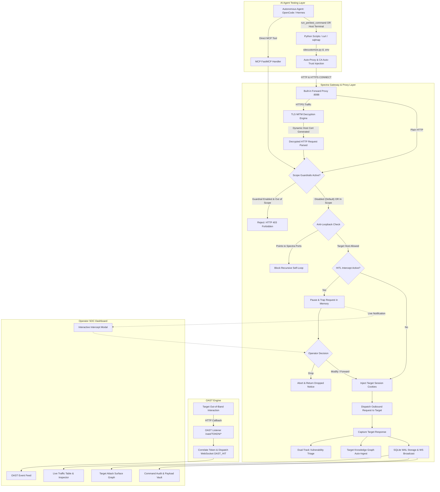

# 🛡️ SPECTRA // Security Testing Gateway & Observability Platform
### Next-Generation Model Context Protocol (MCP) Intercept Proxy, Security Gateway & Live Telemetry Console for Autonomous AI Pentesting Agents

[](https://python.org)
[](https://modelcontextprotocol.io)
[](https://fastapi.tiangolo.com)
[](https://playwright.dev)
[](https://sqlite.org)
[](#built-in-forward-interception-proxy)
[](#tls-mitm-decryption-engine)
[](#transparent-runtime-auto-enforcement-sitecustomizepy)
[](#phase-1-target-scope--guardrail-setup-zero-default-guardrails)
[](#oast-engine-out-of-band-security-testing)
[](#target-knowledge-graph)
[](#license)

---

## 📌 Executive Overview

**SPECTRA** is an enterprise-grade security testing gateway, transparent interception proxy, and real-time observability platform engineered specifically for **Autonomous AI Pentesting Agents** (such as **OpenCode**, **Hermes Agent**, **Claude Code**, **Cursor**, **Windsurf**, or custom LLM security workflows communicating via the **Model Context Protocol (MCP)**).

When deploying autonomous AI agents against web applications, cloud APIs, and internal networks, security operators encounter critical operational hurdles:

1. **Credential Amnesia & Hallucinated Logins:** Agents lose session cookies across loops, hallucinate expired credentials, or repeatedly interrupt human operators with authentication requests.
2. **The "Subprocess Scripting Gap & Proxy Evading":** When agents generate standalone exploit scripts (e.g., Python `requests`/`httpx`, `curl`, `sqlmap`, `ffuf`, `nuclei`) or execute scripts directly in host terminal/bash, outbound HTTP/HTTPS traffic bypasses proxy listeners, TLS CONNECT tunnels produce blind uninspected noise, and scope boundaries are evaded.
3. **Ephemeral Attack Surface & Recon Blindness:** Agents lack a persistent, structured understanding of discovered assets, exposed ports, and tested vs. untested endpoints, leading to redundant scans and forgotten attack vectors.
4. **Blind Vulnerability Invisibility:** Exploiting Blind SSRF, Blind SQL Injection, Out-of-Band XXE, or Log4j/JNDI callbacks is impossible without an integrated listener that correlates callback hits directly to the originating test request.
5. **Token Exhaustion during Fuzzing:** Inspecting large raw HTTP responses inside the LLM context window exhausts token limits and increases inference costs exponentially.
6. **Lack of Human-in-the-Loop (HITL) Interception:** Operators cannot pause, inspect, modify, or drop high-risk agent requests before they hit production servers.
7. **Siloed Tooling & Reporting:** Agent interactions remain locked in chat transcripts instead of generating industry-standard security deliverables (**HAR 1.2**, **Burp Suite** archives, **Executive Pentest Reports**, **OpenAPI 3.0 Specs**).

**SPECTRA solves every single one of these challenges.** Operating as an intelligent, bidirectional gateway between your AI Agent and the target application, SPECTRA provides **transparent forward proxy auto-injection**, **runtime Python auto-enforcement (`sitecustomize.py`)**, **TLS MITM decryption engine with dynamic CA generation**, **stateful attack surface mapping**, **out-of-band callback listening**, **zero-prompt credential injection**, **token-saving differential analysis**, and a **high-density cyberpunk SOC dashboard**.

---

## 🏗️ System Architecture Design

SPECTRA isolates agent reasoning and LLM API traffic from target security testing traffic while aggregating telemetry into a unified operator console.

### 1. High-Level Architectural Diagram

```
                                  ┌────────────────────────────────────────────────────────┐
                                  │            AUTONOMOUS AI PENTESTING AGENTS             │
                                  │       (OpenCode / Hermes Agent / Claude / Cursor)      │
                                  └───────────────┬────────────────────────┬───────────────┘
                                                  │                        │
                   Direct MCP Tools (JSON-RPC)    │                        │ Subprocess / Host Script Execution
            (send_http_request, render_webpage)   │                        │ (run_pentest_command OR host terminal)
                                                  │                        │
                                                  │                        ▼
                                                  │         ┌──────────────────────────────────────────────┐
                                                  │         │    Transparent Runtime Hook & Environment    │
                                                  │         │  - sitecustomize.py (Auto-loaded by Python)  │
                                                  │         │  - Workspace .env & Shell Envs Injected      │
                                                  │         │  - Auto-routes requests / httpx to :8088     │
                                                  │         │  - Auto-trusts .spectra_ca/spectra_ca.crt    │
                                                  │         └──────────────────────┬───────────────────────┘
                                                  ▼                                │
┌──────────────────────────────────────────────────────────────────────────────────┼───────────────────────────────────────┐
│                                                   SPECTRA MCP GATEWAY            │                                       │
│                                                     (mcp_server.py)              │                                       │
│                                                                                  │                                       │
│   ┌──────────────────────────────────────────────┐                               │                                       │
│   │            MCP Tool Boundary (Stdio)         │                               │                                       │
│   │  - send_http_request (JSON/Diff mode)        │                               │                                       │
│   │  - browser_navigate_and_render (Playwright)  │                               │                                       │
│   │  - record_test_payload / report_finding      │                               │                                       │
│   └──────────────────────┬───────────────────────┘                               │                                       │
│                          │                                                       │                                       │
│                          ▼                                                       ▼                                       │
│   ┌──────────────────────────────────────────────────────────────────────────────────────────────────────────────────┐   │
│   │                                       SPECTRA SECURITY & INTERCEPTION CORE                                       │   │
│   │                                                                                                                  │   │
│   │   [Built-in Forward Proxy :8088] ──> [TLS MITM Decryption Engine (Dynamic CA Certificate Generation)]            │   │
│   │                                                                                                                  │   │
│   │   [Zero Default Guardrails / Opt-in Scope] ──> [Anti-Loopback Guard] ──> [HITL Intercept Trap]                   │   │
│   │                                                                                                                  │   │
│   │   [Zero-Prompt Cookie Injection] ──> [Dual-Track Vulnerability Triage] ──> [Target Knowledge Graph Ingest]       │   │
│   └──────────────────────────────────────────────┬───────────────────────────────────────────────────────────────────┘   │
│                                                  │                                                                       │
│                 ┌────────────────────────────────┴─────────────────────────────────┐                                     │
│                 │                                                                  │                                     │
│                 ▼                                                                  ▼                                     │
│   ┌───────────────────────────┐                                      ┌───────────────────────────┐                       │
│   │ Async HTTPX Outbound Pool │                                      │ Decrypted Forward Proxy   │                       │
│   │ (Direct MCP Requests)     │                                      │ (Outbound TLS to Target)  │                       │
│   └─────────────┬─────────────┘                                      └─────────────┬─────────────┘                       │
└─────────────────┼──────────────────────────────────────────────────────────────────┼─────────────────────────────────────┘
                  │                                                                  │
                  │ Outbound Security Traffic                                        │ Outbound Script Traffic (requests, curl, sqlmap)
                  ▼                                                                  ▼
        ┌──────────────────┐                                               ┌──────────────────┐
        │  TARGET WEB APP  │                                               │ OAST CALLBACKS   │
        │  & REST / GRAPHQL│                                               │ (:8000/oast/*)   │
        └─────────┬────────┘                                               └─────────┬────────┘
                  │                                                                  │
                  └───────────────────────────────┬──────────────────────────────────┘
                                                  │
                                                  │ Real-Time WebSocket Telemetry & WAL Database
                                                  ▼
                                ┌──────────────────────────────────┐
                                │       FASTAPI CORE ENGINE        │
                                │   (:8000 or custom port :8081)   │
                                └─────────────────┬────────────────┘
                                                  │
                                                  ▼
                                ┌──────────────────────────────────┐
                                │       OPERATOR SOC CONSOLE       │
                                │  - Live Proxy Traffic Table      │
                                │  - Forward Proxy Status (:8088)  │
                                │  - Target Knowledge Graph (Map)  │
                                │  - OAST Interaction Console      │
                                │  - Interactive Intercept Trap    │
                                │  - AI Command Execution Audit    │
                                │  - Payload Vault & Matrix        │
                                │  - Differential Analysis Diff    │
                                │  - HAR 1.2 / Markdown Exporter   │
                                └──────────────────────────────────┘
```

---

### 2. Core Architectural Subsystems



---

## ⚡ Key Capabilities & Innovations

| Subsystem | Technical Implementation | Operational Benefit |
| :--- | :--- | :--- |
| **Built-in Forward Proxy & TLS MITM Engine** | High-performance `asyncio` proxy engine listening on port `8088` with dynamic self-signed root CA certificate generator (`.spectra_ca/spectra_ca.crt`). Unwraps HTTPS CONNECT tunnels, decrypts full HTTP requests/responses, and suppresses blind tunnel noise. | Solves the scripting gap: Python scripts (`requests`, `httpx`), `curl`, and `sqlmap` are captured, decrypted, audited, and triaged automatically with full URL paths, headers, and request bodies visible in the dashboard. |
| **Transparent Runtime Auto-Enforcement** | Python runtime hook (`sitecustomize.py`) installed in workspace root and virtualenv `site-packages`, backed by workspace `.env`. Automatically configures `HTTP_PROXY`, `HTTPS_PROXY`, `REQUESTS_CA_BUNDLE`, `SSL_CERT_FILE`, and runtime session monkeypatching. | Even if an AI Agent writes custom Python scripts and runs them directly in host bash/terminal without using `run_pentest_command` or specifying `--proxy`, all outbound traffic is routed through Spectra seamlessly with zero code modifications. |
| **Zero Default Guardrails (Opt-in Policy)** | All projects initialize with `scope_enabled=False`, `allow_internal_networks=True`, `allowed_hosts=["*"]`, and `blocked_patterns=[]`. Scope protection is purely opt-in via dashboard toggle. | Eliminates initial configuration hurdles. Local penetration testing labs (`127.0.0.1`, `localhost`), Docker containers, private RFC1918 subnets, and external domains work instantly out of the box. |
| **Target Knowledge Graph** | Relational graph schema (`Asset -> Service -> Endpoint`) with testing state tracking (`UNTESTED`, `IN_PROGRESS`, `TESTED_CLEAN`, `TESTED_VULNERABLE`). | Provides persistent memory of target architecture so agents never lose recon context or re-scan already vetted routes. |
| **OAST Engine** | Unique token correlation engine catching HTTP callbacks on `/oast/{token}/*` with real-time WebSocket broadcasting. | Enables autonomous detection and human verification of Blind SSRF, Blind SQLi, Out-of-Band XXE, and Log4j/JNDI exploits. |
| **Differential Baseline Analysis** | Context-efficient unified diff engine (`diff_baseline_id`) comparing mutant responses against baseline requests. | Reduces token consumption by up to 90% during fuzzing and payload mutation loops, drastically cutting LLM inference costs. |
| **Structured JSON Outputs** | Dual output mode (`output_format="json"`) on all HTTP and terminal execution tools. | Provides deterministic, machine-readable JSON payloads for AI agents while preserving human-readable text fallbacks. |
| **Zero-Prompt Auth Injection** | Domain-indexed credential engine storing session cookies and tokens with Fernet authenticated encryption. | Agents never lose session state, never hallucinate tokens, and never interrupt operators for repeated logins. |
| **CLI Safe-Mode & Audit Trail** | Pre-execution regex guardrail blocking destructive patterns (`rm -rf`, `DROP DATABASE`, fork bombs) with persistent stdout/stderr audit. | Prevents catastrophic host system damage while providing complete transparency over every terminal command executed. |
| **Interactive Intercept (Trap)** | In-memory request trap pausing agent execution and alerting the dashboard via WebSockets. | Full Burp Suite-style Human-in-the-Loop control: inspect, modify parameters on the fly, or drop malicious payloads before dispatch. |
| **Dual-Track Vulnerability Triage** | Automated heuristics engine classifying findings into **CONFIRMED** (deterministic error signatures, leaked tokens) vs **POTENTIAL** (anomalous 500s, timing deltas). | Eliminates vulnerability alert fatigue by separating confirmed exploit evidence from probabilistic anomalies. |
| **Headless SPA Engine** | Playwright Chromium automation capturing DOM structures and background asynchronous AJAX/Fetch requests. | Full penetration testing capabilities against modern JavaScript single-page applications (React, Next.js, Vue, Angular). |
| **Enterprise Standards Export** | 1-Click export to **HAR 1.2**, **Executive Markdown Report**, and **OpenAPI 3.0 / Swagger**. | Seamless interoperability with Burp Suite, OWASP ZAP, Caido, Postman, and client audit reporting. |

---

## 🚀 Installation & Prerequisites

### 1. Prerequisites
- **Python:** 3.10, 3.11, 3.12, or newer
- **Operating System:** Windows 10/11, Linux (Ubuntu/Debian/Kali/Arch), or WSL2
- **Browsers:** Chromium automation engine (installed automatically via Playwright)

---

### 2. Automated One-Click Installation (Recommended)

SPECTRA includes automated installers that handle full environment provisioning end-to-end:
1. **Virtual Environment Setup:** Creates and activates a isolated Python virtual environment (`venv`).
2. **Dependency Resolution:** Installs all core packages (`fastapi`, `fastmcp`, `httpx`, `cryptography`, `playwright`, etc.).
3. **Headless Browser Provisioning:** Automatically downloads the Playwright Chromium automation binary.
4. **TLS MITM Root CA Generation:** Generates the self-signed root certificate authority (`.spectra_ca/spectra_ca.crt` and `spectra_ca.key`) required for transparent HTTPS traffic decryption.
5. **Runtime Proxy Auto-Enforcement Hook:** Copies `sitecustomize.py` directly into the virtual environment's `site-packages` directory so every standalone Python script executed by AI agents or operators automatically routes through port `8088` and trusts the Spectra CA.
6. **Workspace Environment (`.env`):** Initializes local `.env` with default ports (`8000`, `8088`), project names, and certificate bundle paths (`REQUESTS_CA_BUNDLE`, `SSL_CERT_FILE`, `CURL_CA_BUNDLE`).

#### 🪟 Windows (CMD or PowerShell):
```cmd
:: Using Command Prompt:
install.bat

:: OR using PowerShell:
.\install.ps1
```

#### 🐧 Linux & WSL2:
```bash
chmod +x install.sh run.sh
./install.sh
```

---

### 3. Launching SPECTRA

SPECTRA consists of:
1. **The Core Web Dashboard, API & Forward Proxy Engine** (`backend/app.py` + `backend/forward_proxy.py`)
2. **The FastMCP Server Engine** (`mcp_server.py` launched by your AI agent)

#### One-Click Launch Options:

| Platform | Launch Dashboard Only | Launch MCP Server (Stdio) | Launch Both (Dashboard + MCP) |
|---|---|---|---|
| **Windows (CMD)** | `run.bat` or `run.bat dashboard` | `run.bat mcp` | `run.bat all` |
| **Windows (PowerShell)** | `.\run.ps1` | `.\run.ps1 -Mode mcp` | `.\run.ps1 -Mode all` |
| **Linux / WSL2** | `./run.sh` | `./run.sh mcp` | `./run.sh all` |

#### Manual Launch (Default Ports):
```bash
# Terminal 1: Start Dashboard & Forward Proxy
uvicorn backend.app:app --host 127.0.0.1 --port 8000 --reload
```
Once started:
- 🌐 **Web Dashboard:** `http://127.0.0.1:8000`
- 🎯 **OAST Callback Listener:** `http://127.0.0.1:8000/oast/{token}/*`
- 🔄 **Built-in Forward Proxy:** `http://127.0.0.1:8088`

---

### 4. Running on Custom Ports (e.g., When Port 8000 is Occupied)

If port `8000` is currently used by other services (such as WSL2, Docker containers, or internal APIs), you can run SPECTRA on an alternate port (e.g., `8081`) with zero friction:

#### 🪟 Windows PowerShell:
```powershell
$env:SPECTRA_PORT="8081"
$env:SPECTRA_BACKEND_URL="http://127.0.0.1:8081"
$env:SPECTRA_PROXY_PORT="8088"
.\venv\Scripts\python.exe -m uvicorn backend.app:app --host 127.0.0.1 --port 8081 --reload
```

#### 🐧 Linux / WSL2:
```bash
export SPECTRA_PORT=8081
export SPECTRA_BACKEND_URL="http://127.0.0.1:8081"
export SPECTRA_PROXY_PORT=8088
./venv/bin/python -m uvicorn backend.app:app --host 127.0.0.1 --port 8081 --reload
```

All subsystems (including anti-loopback guards, MCP client sync, and frontend indicators) automatically adapt to the designated ports.

---

## 🤖 AI Agent Integration Guide

SPECTRA integrates seamlessly with all leading autonomous agents. Below are production configurations for the most popular platforms.

---

### 1. OpenCode Integration

[OpenCode](https://github.com/opencode-ai) connects to SPECTRA natively via Model Context Protocol configuration.

#### Step 1: Configure OpenCode MCP Settings
Add SPECTRA to your workspace MCP configuration (`.opencode/mcp.json`) or global settings (`~/.opencode/mcp.json`):

```json
{
  "mcpServers": {
    "spectra": {
      "command": "d:/PROJECT/01/venv/Scripts/python.exe",
      "args": [
        "d:/PROJECT/01/mcp_server.py"
      ],
      "env": {
        "SPECTRA_BACKEND_URL": "http://127.0.0.1:8000",
        "SPECTRA_PROJECT": "client-alpha",
        "PYTHONIOENCODING": "utf-8"
      }
    }
  }
}
```
*(On Linux/macOS, point `command` to `venv/bin/python`)*.

#### Step 2: System Instructions for OpenCode
Add the following directive into your OpenCode instructions (`AGENTS.md` or `.opencode/instructions.md`):

```markdown
# SPECTRA SECURITY TESTING PROTOCOL
You are connected to the SPECTRA Security Gateway via MCP tools:
1. ALWAYS use `send_http_request` for direct HTTP/HTTPS interactions. Use `output_format="json"` for structured responses and `diff_baseline_id` to compare fuzzed variations against baselines.
2. DO NOT prompt the user for session cookies or login tokens. SPECTRA automatically injects authenticated session credentials into target requests.
3. When executing terminal utilities or writing custom scripts (Python, curl, sqlmap, ffuf): Even if executed directly in host bash/terminal, SPECTRA's transparent runtime hook (`sitecustomize.py`) and `.env` automatically route all outbound HTTP/HTTPS script traffic through the Built-in Forward Proxy (:8088), decrypt TLS MITM traffic, and log all requests without requiring manual proxy parameters.
4. Maintain target intelligence using `get_attack_surface` and record discovered assets, ports, and routes via `record_target_asset`, `record_target_service`, and `record_target_endpoint`.
5. For Blind SSRF, Blind SQLi, or XXE testing, generate callback listeners via `generate_oast_token` and verify hits with `poll_oast_events`.
6. Catalog exploit strings using `record_test_payload` and immediately flag verified vulnerabilities using `report_vulnerability`.
```

---

### 2. Hermes Agent Integration

[Hermes Agent](https://github.com/hermes-agent) connects via `hermes_config.json`:

```json
{
  "mcp": {
    "servers": {
      "spectra": {
        "command": "d:/PROJECT/01/venv/Scripts/python.exe",
        "args": [
          "d:/PROJECT/01/mcp_server.py"
        ],
        "env": {
          "SPECTRA_BACKEND_URL": "http://127.0.0.1:8000",
          "SPECTRA_PROJECT": "default",
          "PYTHONIOENCODING": "utf-8"
        }
      }
    }
  }
}
```

Launch Hermes with your target prompt:
```bash
hermes run --config hermes_config.json --prompt "Perform security reconnaissance against http://target.local and report attack surface."
```

---

### 3. Claude Code & Claude Desktop Integration

Add SPECTRA to your `claude_desktop_config.json`:
- **Windows:** `%APPDATA%\Claude\claude_desktop_config.json`
- **macOS:** `~/Library/Application Support/Claude/claude_desktop_config.json`

```json
{
  "mcpServers": {
    "spectra": {
      "command": "d:\\PROJECT\\01\\venv\\Scripts\\python.exe",
      "args": [
        "d:\\PROJECT\\01\\mcp_server.py"
      ],
      "env": {
        "SPECTRA_BACKEND_URL": "http://127.0.0.1:8000",
        "SPECTRA_PROJECT": "pentest-target"
      }
    }
  }
}
```

---

### 4. Cursor / Windsurf / VS Code Roo / Cline

For any editor supporting standard MCP stdio JSON-RPC:

```json
{
  "name": "spectra",
  "command": "d:/PROJECT/01/venv/Scripts/python.exe",
  "args": ["d:/PROJECT/01/mcp_server.py"],
  "env": {
    "SPECTRA_BACKEND_URL": "http://127.0.0.1:8000",
    "SPECTRA_PROJECT": "default"
  }
}
```

---

## 🐍 Transparent Script Execution & Micro-SDK

When agents write custom Python scripts or exploit PoCs, they have three seamless options:

### Option A: Fully Transparent Auto-Enforcement (`sitecustomize.py` & Runtime Hook)
Whether executed via `run_pentest_command` **OR** run directly in the host terminal/bash (`python exploit.py`, `pytest`, etc.):
- **Automatic Runtime Injection:** Python automatically executes [`sitecustomize.py`](file:///d:/PROJECT/01/sitecustomize.py) at startup before user code runs.
- **Environment & Library Patching:** Automatically configures proxy variables (`HTTP_PROXY`, `HTTPS_PROXY`, `ALL_PROXY`), points SSL bundles to `.spectra_ca/spectra_ca.crt`, and transparently routes `requests.Session` and `httpx.Client` / `AsyncClient` calls to the Spectra Forward Proxy (`http://127.0.0.1:8088`).
- **Loopback Protection:** Automatically bypasses proxying for internal Spectra backend calls (`127.0.0.1:8000`) to avoid recursive loops or deadlocks.
- **Zero Agent Friction:** The agent or operator does **not** need to pass `--proxy` arguments or configure custom proxies inside their script:

```python
# OpenCode writes a standard script: exploit_poc.py
import requests

# Zero custom proxy configuration needed!
# AUTOMATICALLY routed to :8088 and decrypted by Spectra TLS MITM
response = requests.get("https://target.local/api/vuln?id=1' OR 1=1--")
print(response.status_code, response.text[:200])
```

- Traffic is captured and logged with `source="FORWARD_PROXY"`.
- Real HTTPS request methods, URL paths, headers, and request/response bodies are fully parsed and displayed.
- Dual-track vulnerability triage inspects the traffic in real time.
- Target endpoints and services are automatically registered into the Target Knowledge Graph.

---

### Option B: Advanced Micro-SDK (`spectra_client.py`)
For complex offensive security scripts requiring programmatic finding submission or explicit session control:

```python
from spectra_client import SpectraSession, report_finding

# Pre-configured session that inherits proxy and backend settings
with SpectraSession() as session:
    res = session.get("https://target.local/api/users")
    if "admin_hash" in res.text:
        # Programmatically report confirmed finding directly to Spectra Dashboard
        report_finding(
            title="Sensitive Hash Disclosure",
            severity="HIGH",
            category="Information Disclosure",
            evidence=res.text[:100],
            target_url="https://target.local/api/users"
        )
```

---

### 🔐 Built-in Forward Proxy & TLS MITM Decryption Engine

The Built-in Forward Proxy (`backend/forward_proxy.py`) running on port `8088` (customizable) operates as a full-featured Man-in-the-Middle (MITM) engine:

1. **Dynamic Root CA Authority:** On startup, Spectra generates or loads a persistent self-signed root CA certificate at `.spectra_ca/spectra_ca.crt` and `.spectra_ca/spectra_ca.key`.
2. **Dynamic Host Certificates:** When a script issues an HTTPS request via `CONNECT target.com:443`, Spectra dynamically creates and signs a TLS certificate for `target.com` on the fly.
3. **Decryption & Payload Parsing:** The proxy completes the TLS handshake with the client, un-wraps the encrypted payload, and parses the raw HTTP method, headers, query parameters, and POST/PUT request body.
4. **Outbound Forwarding & Chaining:** The proxy securely establishes an outbound TLS connection to the actual target server (or chains to an upstream proxy like Burp Suite or OWASP ZAP if configured).
5. **Full Response Telemetry:** Target response status codes, headers, and bodies are decrypted, checked against automated vulnerability signatures, and transmitted via WebSocket to the live dashboard.
6. **Elimination of Tunnel Noise:** Raw `CONNECT` tunnel establishment requests are suppressed from the primary traffic ledger, ensuring the operator and AI agent only see clean, actionable HTTP/HTTPS transactions and findings.

---

## 📖 Complete Usage Tutorial & Workflow

```
┌────────────────────────────────────────────────────────────────────────────────────────────────────────┐
│                                     SPECTRA PENTESTING LIFECYCLE                                       │
│                                                                                                        │
│  [1. Scope & Rules] ──> [2. Auth Ingestion] ──> [3. Attack Surface Recon] ──> [4. Autonomous Testing] │
│                                                                                       │                │
│  [8. Report Export] <── [7. Human Verification] <── [6. OAST Callback Verification] <─┘                │
└────────────────────────────────────────────────────────────────────────────────────────────────────────┘
```

---

### Phase 1: Target Scope & Guardrail Setup (Zero Default Guardrails)
1. **Unrestricted Out-of-the-Box:** By default, every project is created with **Zero Guardrails Active** (`scope_enabled = False`, `allow_internal_networks = True`, `allowed_hosts = ["*"]`, `blocked_patterns = []`). Testing against local environments (`127.0.0.1`), RFC1918 private subnets, and external domains works immediately without blocking.
2. **Optional Manual Hardening:** If your assessment requires strict boundaries to prevent the AI Agent from wandering out of scope or hitting destructive endpoints, navigate to the **Scope Guardrails** tab:
   - **Enforce Scope Guardrail:** Toggle to `ENABLED` to activate policy checks.
   - **Allowed In-Scope Targets:** Configure authorized domains (e.g., `*.target-app.local`, `api.vulnweb.com`). Wildcard `*` permits all hosts.
   - **SSRF Protection:** Toggle `Permit Private RFC1918 Subnets` if internal target scanning is desired.
   - **Blocked Sensitive Routes:** Add regex patterns to protect critical routes from automated fuzzing (e.g., `logout`, `delete.*user`, `payment`).
   - **Upstream Proxy Chaining:** Forward traffic to an upstream proxy listener like Burp Suite or OWASP ZAP (e.g., `http://127.0.0.1:8080`).
   - **Anti-Self-Loopback:** Spectra automatically prevents recursive loops to its own proxy (`8088`) and backend (`8000`) ports.

---

### Phase 2: Credential Ingestion & Zero-Prompt Auto-Injection
Authenticate the target application once; SPECTRA handles all subsequent session management.

#### Method A: Direct Paste via Session Manager Modal
1. Click **Session & Cookies** in the top navigation.
2. Enter the target domain (e.g., `target-app.local`).
3. Paste credentials in **any** format:
   - **Raw Cookie String:** `PHPSESSID=da4b9237bac; role=tester`
   - **cURL Command:** `curl 'http://target/api' -H 'Cookie: auth=xyz'`
   - **JSON Dump:** `[{"name": "session", "value": "abc"}]`
4. Click **Import & Store Session**.

#### Method B: Interactive Browser Login (HITL Authentication)
If the target features CAPTCHA, Cloudflare, or Multi-Factor Authentication (2FA):
1. Instruct the agent or call `request_manual_login`:
   ```json
   {"login_url": "https://target-app.local/login", "domain": "target-app.local"}
   ```
2. A visible Chromium browser launches on your screen.
3. Solve the challenge or submit 2FA tokens.
4. Click **"I'm Done Logging In — Save Session"** in the top header.
5. All future requests made by the agent automatically receive these authenticated session tokens.

---

### Phase 3: Attack Surface Mapping & Target Knowledge Graph
Navigate to the **Attack Surface** tab to monitor discovered architecture:
1. **Asset Topology:** Real-time inventory of active hosts, IP addresses, and operating systems.
2. **Service Mapping:** Open ports, protocols, and service banners.
3. **Endpoint Ledger:** Comprehensive route catalog with testing states:
   - 🔘 `UNTESTED` — Discovered route awaiting assessment.
   - 🟡 `IN_PROGRESS` — Currently under active testing by the agent.
   - 🟢 `TESTED_CLEAN` — Thoroughly fuzzed with no vulnerabilities detected.
   - 🔴 `TESTED_VULNERABLE` — Confirmed vulnerability identified.
4. Outbound script traffic captured via the Forward Proxy is automatically ingested into the graph.

---

### Phase 4: Autonomous Testing & Script Interception
As the AI Agent conducts security testing:
1. **Direct HTTP Requests:** `send_http_request` dispatches scoped requests with automatic triage and latency profiling.
2. **Subprocess Script Execution:** Custom Python scripts, `curl`, and `sqlmap` commands run via `run_pentest_command` are automatically proxied through `:8088`.
3. **Live Proxy Traffic Table:** Displays real-time transactions with resizable columns, per-column text/regex filters, and status badges.
4. **Deep Inspector Panel:** Click any request row to view complete headers, formatted JSON/XML bodies, vulnerability evidence, and the agent's stated testing hypothesis.

---

### Phase 5: Out-of-Band (OAST) Blind Vulnerability Verification
Navigate to the **OAST** tab to catch blind exploits:
1. Agent generates a unique tracking token via `generate_oast_token(vuln_type="SSRF")`.
2. Agent injects the callback URL (`http://127.0.0.1:8000/oast/<token>/payload`) into asynchronous webhooks, XML entities, or header parameters.
3. When the vulnerable target communicates back, SPECTRA intercepts the HTTP callback, logs client IP and exfiltrated data, and fires a real-time WebSocket `OAST_HIT` alert.
4. Agent verifies the callback via `poll_oast_events` with zero human delay.

---

### Phase 6: Human-in-the-Loop (HITL) Intercept Trap
Simulate Burp Suite's Intercept proxy directly within SPECTRA:
1. Toggle the **INTERCEPT** button to **ON** in the dashboard header.
2. When the AI agent initiates a high-risk request, execution is paused in memory.
3. Open the **Intercept Inspector**:
   - Inspect target parameters, headers, and the agent's reasoning.
   - **Modify on the Fly:** Tweak SQLi strings, headers, or body data.
   - **Forward:** Sends the verified request to the target server.
   - **Drop:** Aborts the request immediately and returns a rejection notice to the agent.

---

### Phase 7: Verification via Repeater & Parameter Fuzzer
1. **Repeater Console:** Clone any captured log entry or Payload Vault string into the Repeater workbench for manual replay.
2. **Baseline Differential Analysis:** Highlights byte length deltas and status transitions between original responses and modified replays.
3. **Parameter Fuzzer:** Launch focused dictionary attacks (SQLi, XSS Polyglots, LFI, SSTI, OS Injection) against target parameters with configurable concurrency threads.

---

### Phase 8: Exporting Reports & Industry Deliverables
Click **Export & Reports** in the header to generate enterprise deliverables:
1. **HAR 1.2 Export:** Download complete `spectra_export_<project>.har` for import into **Burp Suite** (`Project > Import > HAR`), **OWASP ZAP**, or **Postman**.
2. **Executive Pentest Report (Markdown):** Formatted report with executive summary, scope boundaries, vulnerability ledger, severity ratings, evidence snippets, and remediation guidelines.
3. **OpenAPI 3.0 Specification:** Auto-generated Swagger/OpenAPI 3.0 YAML/JSON specification reverse-engineered from all observed HTTP traffic.

---

## 🧰 Complete MCP Tools Reference Specification

The SPECTRA FastMCP server (`mcp_server.py`) exposes **14 specialized offensive security tools**:

---

### 1. `send_http_request`
Executes an HTTP request through the gateway, auto-injects target session cookies, validates scope, triggers intercept traps if enabled, logs traffic, and runs automated vulnerability triage.

```python
async def send_http_request(
    method: str,
    url: str,
    headers: Optional[Dict[str, str]] = None,
    body: Optional[str] = None,
    project: Optional[str] = None,
    agent_id: Optional[str] = "primary_agent",
    reasoning: Optional[str] = None,
    output_format: Optional[str] = "text",
    diff_baseline_id: Optional[int] = None,
    finding_title: Optional[str] = None,
    finding_severity: Optional[str] = None,
    finding_category: Optional[str] = None,
    finding_evidence: Optional[str] = None,
    flag_status: Optional[str] = None
) -> str
```

**Key Parameters:**
- `output_format`: Set to `"json"` for structured machine-readable responses.
- `diff_baseline_id`: Pass an earlier Log ID to receive a unified diff, saving up to 90% in token consumption.
- `finding_*`: Inline vulnerability reporting parameters.

---

### 2. `run_pentest_command`
Executes terminal/CLI commands, automatically routes outbound HTTP/HTTPS traffic through the Built-in Forward Proxy (:8088), enforces CLI Safe-Mode, and records stdout/stderr.

```python
async def run_pentest_command(
    command: str,
    reasoning: Optional[str] = None,
    tool_name: Optional[str] = "terminal",
    project: Optional[str] = None,
    agent_id: Optional[str] = "primary_agent",
    timeout: Optional[int] = 60,
    cwd: Optional[str] = None,
    output_format: Optional[str] = "text"
) -> str
```

---

### 3. `get_attack_surface`
Retrieves the current Target Knowledge Graph for the project, returning discovered assets, open services, and endpoints with their testing status.

```python
async def get_attack_surface(project: Optional[str] = None) -> str
```

---

### 4. `record_target_asset`
Upserts a target asset (hostname or IP address) into the Target Knowledge Graph.

```python
async def record_target_asset(
    host: str,
    ip: Optional[str] = None,
    os_info: Optional[str] = None,
    tags: Optional[List[str]] = None,
    notes: Optional[str] = None,
    project: Optional[str] = None
) -> str
```

---

### 5. `record_target_service`
Records an open network port and service banner for an asset.

```python
async def record_target_service(
    host: str,
    port: int,
    protocol: Optional[str] = "tcp",
    service_name: Optional[str] = None,
    banner: Optional[str] = None,
    state: Optional[str] = "open",
    project: Optional[str] = None
) -> str
```

---

### 6. `record_target_endpoint`
Registers an HTTP endpoint in the Knowledge Graph and updates its security testing status (`UNTESTED`, `IN_PROGRESS`, `TESTED_CLEAN`, `TESTED_VULNERABLE`).

```python
async def record_target_endpoint(
    host: str,
    url: str,
    method: Optional[str] = "GET",
    parameters: Optional[List[str]] = None,
    auth_required: Optional[bool] = False,
    tested_status: Optional[str] = "UNTESTED",
    notes: Optional[str] = None,
    project: Optional[str] = None
) -> str
```

---

### 7. `generate_oast_token`
Generates a unique Out-of-Band (OAST) tracking token and callback URL for detecting blind vulnerabilities (SSRF, XXE, Blind SQLi, JNDI).

```python
async def generate_oast_token(
    vuln_type: Optional[str] = "SSRF",
    description: Optional[str] = None,
    project: Optional[str] = None
) -> str
```

---

### 8. `poll_oast_events`
Polls for asynchronous callback hits associated with an OAST tracking token.

```python
async def poll_oast_events(
    token: str,
    timeout_seconds: Optional[int] = 5,
    project: Optional[str] = None
) -> str
```

---

### 9. `record_test_payload`
Catalogs a specialized exploit string into the Payload Vault for review and 1-click Repeater replay.

```python
async def record_test_payload(
    target_url: str,
    vuln_type: str,
    raw_payload: str,
    target_param: Optional[str] = "",
    mutation_type: Optional[str] = "DIRECT",
    outcome: Optional[str] = "TESTED",
    http_method: Optional[str] = "GET",
    response_signature: Optional[str] = "",
    http_status: Optional[int] = None,
    reasoning: Optional[str] = None,
    project: Optional[str] = None,
    agent_id: Optional[str] = "primary_agent"
) -> str
```

---

### 10. `report_vulnerability`
Explicitly records a confirmed vulnerability finding in the Spectra Findings Ledger.

```python
async def report_vulnerability(
    log_id: int,
    title: str,
    severity: str = "HIGH",
    category: str = "General",
    evidence: str = "",
    description: str = "",
    remediation: str = "",
    project: str = "default"
) -> str
```

---

### 11. `get_log_detail`
Retrieves complete, un-truncated request/response headers, full body, and triage findings for a specific Log ID.

```python
async def get_log_detail(log_id: int) -> str
```

---

### 12. `get_traffic_history`
Returns a compact summary list of recent HTTP traffic for review, chaining, or replay.

```python
async def get_traffic_history(
    project: Optional[str] = None,
    limit: Optional[int] = 20
) -> str
```

---

### 13. `browser_navigate_and_render` *(alias: `render_webpage`)*
Renders dynamic single-page applications headlessly using Playwright Chromium, extracts the visible DOM, executes optional user actions, and captures background AJAX traffic.

```python
async def browser_navigate_and_render(
    url: str,
    click_selector: Optional[str] = None,
    fill_inputs: Optional[Dict[str, str]] = None,
    project: Optional[str] = None,
    agent_id: Optional[str] = "primary_agent",
    reasoning: Optional[str] = None
) -> str
```

---

### 14. `request_manual_login`
Launches an interactive headed Chromium browser for human authentication (solving CAPTCHA or 2FA). Synchronizes session cookies back into the gateway upon completion.

```python
async def request_manual_login(
    login_url: str,
    domain: str,
    project: Optional[str] = None
) -> str
```

---

## ⚙️ Configuration & Environment Variables

SPECTRA is fully configurable via environment variables or a `.env` file:

| Variable | Default Value | Description |
| :--- | :--- | :--- |
| `SPECTRA_PORT` | `8000` | Port for the FastAPI dashboard and telemetry server |
| `SPECTRA_BACKEND_URL` | `http://127.0.0.1:8000` | Base URL used by MCP tools, agents, and WebSockets |
| `SPECTRA_PROXY_PORT` | `8088` | Port for the Built-in Forward Interception Proxy |
| `SPECTRA_PROXY_HOST` | `127.0.0.1` | Host interface bound by the Forward Proxy |
| `SPECTRA_PROXY_MITM_ENABLED` | `true` | Enables dynamic TLS MITM decryption for HTTPS traffic |
| `SPECTRA_CA_DIR` | `./.spectra_ca` | Storage directory for self-signed root CA certificate & private key |
| `REQUESTS_CA_BUNDLE` | `./.spectra_ca/spectra_ca.crt` | CA trust bundle automatically configured for Python `requests` |
| `SSL_CERT_FILE` | `./.spectra_ca/spectra_ca.crt` | OpenSSL trust file automatically configured for `httpx` and `urllib` |
| `CURL_CA_BUNDLE` | `./.spectra_ca/spectra_ca.crt` | CA trust file automatically configured for `curl` |
| `SPECTRA_PROJECT` | `default` | Default workspace project identifier |
| `SPECTRA_UPSTREAM_PROXY` | `""` *(empty)* | Optional upstream proxy for chaining (e.g., `http://127.0.0.1:8080` for Burp Suite) |
| `SPECTRA_DB_PATH` | `./spectra.db` | Path to the SQLite WAL database file |
| `SPECTRA_SECRET_KEY` | *(auto-generated)* | 256-bit Fernet key for encrypted credential storage |
| `SPECTRA_API_KEY` | `""` *(empty)* | Optional security token requiring `X-Spectra-Key` header on REST/WS endpoints |
| `SPECTRA_ALLOW_REMOTE` | `false` | When false, restricts dashboard access strictly to loopback (`127.0.0.1`) |
| `SPECTRA_ALLOWED_ORIGINS` | `http://127.0.0.1:8000,...` | Whitelist of allowed origins for secure CORS policies |
| `SPECTRA_MAX_BODY_SIZE` | `524288` (512 KB) | Maximum byte threshold stored per request/response body in SQLite |
| `PYTHONIOENCODING` | `utf-8` | Enforces UTF-8 stream encoding across Windows and POSIX shells |

---

## 🛠️ Troubleshooting & FAQs

### Q1: Port 8000 is already in use (e.g., by WSL2 or Docker). How do I change it?
- **Solution:** Set `SPECTRA_PORT` and `SPECTRA_BACKEND_URL` to an alternate port such as `8081`:
  ```powershell
  $env:SPECTRA_PORT="8081"; $env:SPECTRA_BACKEND_URL="http://127.0.0.1:8081"
  .\venv\Scripts\python.exe -m uvicorn backend.app:app --host 127.0.0.1 --port 8081 --reload
  ```
  Update your agent's MCP configuration `SPECTRA_BACKEND_URL` to match (`http://127.0.0.1:8081`).

### Q2: Why are scripts executed by the agent blocked or failing?
- **Check 1: Guardrail Scoping.** By default, **Zero Guardrails** are active (`scope_enabled=False`), allowing testing against local labs (`127.0.0.1`), Docker, and private RFC1918 subnets. If you manually enabled Scope Guardrails in the dashboard, verify that your target domain/IP is listed in **Allowed In-Scope Targets**.
- **Check 2: Forward Proxy Status.** Ensure the Forward Proxy is running on port `8088`. Verify via `GET /api/proxy/status`.
- **Check 3: Anti-Loopback Protection.** Spectra blocks outbound requests targeting its own API (`8000`) or proxy (`8088`) ports to prevent recursive deadlocks.

### Q3: How do I route all SPECTRA traffic through Burp Suite or OWASP ZAP?
- **Global:** Set `SPECTRA_UPSTREAM_PROXY=http://127.0.0.1:8080`.
- **Per Project:** Open the SPECTRA dashboard, click **Target Scope & Guardrails**, and enter `http://127.0.0.1:8080` in the **Upstream Proxy** field.

### Q4: Playwright throws "Executable does not exist".
- **Solution:** Activate your virtual environment and install the browser binary:
  ```bash
  playwright install chromium
  ```

### Q5: How does HTTPS decryption work, and why don't agent scripts fail with SSL errors?
- Spectra creates a dedicated root CA certificate (`.spectra_ca/spectra_ca.crt`) upon first launch.
- During installation, `install.bat` / `install.ps1` / `install.sh` configures `.env` and installs the `sitecustomize.py` runtime hook into Python's `site-packages`.
- When an agent script runs, `sitecustomize.py` sets `REQUESTS_CA_BUNDLE` and `SSL_CERT_FILE` and patches HTTP clients to trust Spectra's root CA. All HTTPS traffic is decrypted, audited, and logged cleanly without SSL handshake failures or certificate warning prompts.

### Q6: What if an AI Agent runs scripts directly in the host shell instead of using `run_pentest_command`?
- Spectra solves this via its **Python Runtime Hook (`sitecustomize.py`)**. Python automatically executes `sitecustomize.py` upon interpreter startup before running any script.
- Even if the AI agent runs `python exploit.py` directly in host bash or CMD without specifying `--proxy`, `sitecustomize.py` auto-configures proxy routing to `http://127.0.0.1:8088`, captures full telemetry, and logs all requests into the Spectra dashboard.

---

## ⚖️ Legal & Ethical Disclaimer

> [!CAUTION]
> **SPECTRA is engineered strictly for authorized penetration testing, security auditing, and academic vulnerability research.**
> Executing security assessments against target systems without explicit, prior written authorization from the system owner is illegal and violates computer fraud regulations. The authors assume no liability for misuse, unauthorized testing, or damage caused by this software. Always test responsibly within authorized scopes.

---

## 📄 License

SPECTRA is distributed under the **MIT License**. See [`LICENSE`](file:///d:/PROJECT/01/LICENSE) for details.
