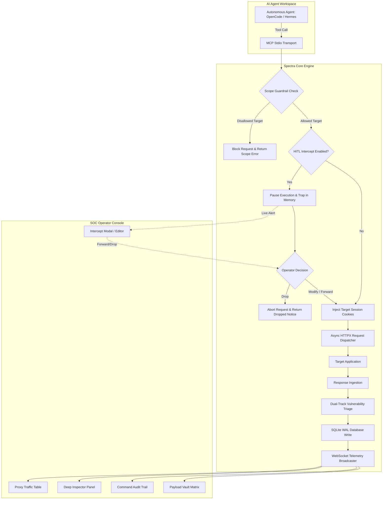

# 🛡️ SPECTRA // Security Testing Gateway & Observability Platform
### Next-Generation Model Context Protocol (MCP) Intercept Proxy, Security Gateway & Live Telemetry Console for Autonomous AI Pentesting Agents

[](https://python.org)
[](https://modelcontextprotocol.io)
[](https://fastapi.tiangolo.com)
[](https://playwright.dev)
[](https://sqlite.org)
[](#license)

---

## 📌 Executive Overview

**SPECTRA** is a high-performance security testing gateway, interception proxy, and real-time observability platform engineered specifically for **Autonomous AI Pentesting Agents** (such as **OpenCode**, **Hermes Agent**, **Claude Code**, **Cursor**, **Windsurf**, or any LLM agent client communicating via the **Model Context Protocol (MCP)**).

When deploying autonomous AI agents against web targets and network APIs, security teams encounter five critical operational hurdles:
1. **Credential Amnesia & Hallucinated Logins:** Agents frequently lose session cookies, hallucinate invalid credentials, or repeatedly prompt human operators for tokens.
2. **Opaque Execution & Unaudited Commands:** Shell commands (`nmap`, `sqlmap`, `curl`, `ffuf`) run invisibly in local processes with no central audit trail or guardrails against accidental destructive actions (e.g., `rm -rf /`, database drops).
3. **Lost Exploit Payloads:** Security testing mutations (SQLi, XSS, SSRF, SSTI, LFI, RCE) generated by LLMs are scattered across chat transcripts without structured tracking or easy replay mechanisms.
4. **Lack of Human-in-the-Loop (HITL) Interception:** Operators cannot pause, inspect, modify, or drop high-risk agent requests before they reach the target server.
5. **No Enterprise Tool Interoperability:** Agent interactions remain siloed inside chat sessions instead of producing standardized security artifacts (**HAR 1.2**, **Burp Suite** import, **Executive Pentest Reports**, **OpenAPI 3.0 Specs**).

**SPECTRA bridges this gap entirely.** By acting as an intelligent Model Context Protocol bridge between the AI Agent and the target application, SPECTRA provides **zero-prompt session auto-injection**, **CLI safe-mode command auditing**, **payload cataloging**, **real-time traffic interception**, and a **high-density cyberpunk SOC dashboard**.

---

## 🏗️ System Architecture Design

SPECTRA follows a decoupled, multi-tiered architecture that isolates agent reasoning and LLM API traffic from target security testing traffic while feeding live telemetry to a unified operator console.

### 1. High-Level Architectural Diagram

```
                                  ┌────────────────────────────────────────────────────────┐
                                  │            AUTONOMOUS AI PENTESTING AGENTS             │
                                  │       (OpenCode / Hermes Agent / Claude / Cursor)      │
                                  └───────────────────────────┬────────────────────────────┘
                                                              │
                                                              │ MCP Protocol (JSON-RPC over Stdio)
                                                              ▼
┌──────────────────────────────────────────────────────────────────────────────────────────────────────────────────────────┐
│                                                   SPECTRA MCP GATEWAY                                                    │
│                                                     (mcp_server.py)                                                      │
│                                                                                                                          │
│   ┌────────────────────────┐  ┌────────────────────────┐  ┌────────────────────────┐  ┌──────────────────────────────┐   │
│   │   send_http_request    │  │   run_pentest_command  │  │  record_test_payload   │  │  browser_navigate_and_render │   │
│   └───────────┬────────────┘  └───────────┬────────────┘  └───────────┬────────────┘  └──────────────┬───────────────┘   │
│               │                           │                           │                              │                   │
│               ▼                           ▼                           ▼                              ▼                   │
│   ┌────────────────────────┐  ┌────────────────────────┐  ┌────────────────────────┐  ┌──────────────────────────────┐   │
│   │ Scope & Guardrail Rule │  │ CLI Safe-Mode Engine   │  │ Structured Payload     │  │ Playwright Headless Engine   │   │
│   │ Verification (Regex)   │  │ (Blocks Destructive)   │  │ Vault Ingestion        │  │ & AJAX Sub-request Sniffer   │   │
│   └───────────┬────────────┘  └───────────┬────────────┘  └───────────┬────────────┘  └──────────────┬───────────────┘   │
│               │                           │                           │                              │                   │
│               ▼                           │                           │                              │                   │
│   ┌────────────────────────┐              │                           │                              │                   │
│   │ HITL Intercept Trap    │              │                           │                              │                   │
│   │ (Pause/Edit/Drop Mode) │              │                           │                              │                   │
│   └───────────┬────────────┘              │                           │                              │                   │
│               │                           │                           │                              │                   │
│               ▼                           │                           │                              │                   │
│   ┌────────────────────────┐              │                           │                              │                   │
│   │ Zero-Prompt Credential │              │                           │                              │                   │
│   │ Cookie Auto-Injector   │              │                           │                              │                   │
│   └───────────┬────────────┘              │                           │                              │                   │
│               │                           │                           │                              │                   │
│               ▼                           │                           │                              │                   │
│   ┌────────────────────────┐              │                           │                              │                   │
│   │ Dual-Track Vulnerability              │                           │                              │                   │
│   │ Triage (Heuristics)    │              │                           │                              │                   │
│   └───────────┬────────────┘              │                           │                              │                   │
└───────────────┼───────────────────────────┼───────────────────────────┼──────────────────────────────┼───────────────────┘
                │                           │                           │                              │
                │ Outbound Security Traffic │ Subprocess Execution      │ In-Memory Sync               │ Headless Render
                ▼                           ▼                           ▼                              ▼
      ┌──────────────────┐        ┌──────────────────┐        ┌──────────────────┐           ┌──────────────────┐
      │  TARGET WEB APP  │        │ LOCAL SHELL / OS │        │ SPECTRA WAL DB   │           │ TARGET DOM / SPA │
      │  & REST / GRAPHQL│        │ (nmap/sqlmap/CLI)│        │  (spectra.db)    │           │ (Chromium JS)    │
      └──────────────────┘        └──────────────────┘        └─────────┬────────┘           └──────────────────┘
                                                                        │
                                                                        │ Real-Time Broadcast via WebSockets
                                                                        ▼
                                                      ┌──────────────────────────────────┐
                                                      │       FASTAPI CORE SERVER        │
                                                      │         (:8000 Web UI)           │
                                                      └─────────────────┬────────────────┘
                                                                        │
                                                                        ▼
                                                      ┌──────────────────────────────────┐
                                                      │       OPERATOR SOC CONSOLE       │
                                                      │  - Live Proxy Traffic Table      │
                                                      │  - Deep HTTP/S Inspector         │
                                                      │  - Interactive Intercept Trap    │
                                                      │  - AI Command Execution Trail    │
                                                      │  - Payload Vault & Matrix        │
                                                      │  - Manual Repeater & Fuzzer      │
                                                      │  - HAR 1.2 / Markdown Exporter   │
                                                      └──────────────────────────────────┘
```

---

### 2. Core Architectural Subsystems



#### A. The MCP Transport & Tool Boundary
- Operates as a standards-compliant **FastMCP** server over `stdio`.
- Exposes five purpose-built offensive security tools:
  1. `send_http_request`: Core HTTP interaction tool with automatic header construction, credential injection, latency tracking, and triage.
  2. `run_pentest_command`: Terminal/CLI execution with regex safety guardrails and full output streaming.
  3. `record_test_payload`: Ingestion tool for vulnerability mutations and testing results.
  4. `browser_navigate_and_render` (alias: `render_webpage`): Headless Chromium browser automation with DOM extraction and network sniffer.
  5. `request_manual_login`: Spawns a headed browser window for operator authentication (2FA, CAPTCHA, SAML/SSO).

#### B. Zero-Prompt Credential Auto-Injection Engine
- Maintains active authentication states in SQLite indexed by host/domain.
- Before every outbound HTTP request, SPECTRA inspects the target URL's domain, retrieves matching session cookies, and injects them seamlessly into the `Cookie` header.
- The AI agent never needs to manage raw auth tokens or prompt the operator for cookies during penetration testing loops.

#### C. CLI Safe-Mode Guardrail Subsystem
- Inspects every command passed to `run_pentest_command` against dangerous pattern regular expressions before invoking `asyncio.create_subprocess_shell`.
- Automatically blocks high-risk operations such as:
  - Destructive disk operations (`rm -rf /`, `rm -rf *`, `mkfs`, `dd if=`)
  - Direct database drops (`DROP DATABASE`, `DROP TABLE`)
  - Fork bombs (`:(){ :|:& };:`)
  - System power operations (`shutdown`, `reboot`, `format C:`)
- Non-zero exit codes, stdout, stderr, and execution duration are recorded and dispatched directly to the live audit log.

#### D. Dual-Track Vulnerability Triage Engine (`backend/analyzer.py`)
- Analyzes all HTTP request and response pairs in real time:
  - **CONFIRMED (Deterministic):** Identifies definitive SQL error signatures (MySQL, PostgreSQL, MSSQL, Oracle, SQLite), exposed private keys/JWTs/AWS secrets, and unescaped reflected XSS strings.
  - **POTENTIAL (Probabilistic):** Flags 500-series internal application errors, unexpected MIME type transitions, debug stack traces, and anomalous latency spikes.

#### E. High-Throughput Database & Telemetry Layer (`backend/database.py` & `app.py`)
- Powered by **SQLite** configured in **Write-Ahead Logging (WAL)** mode (`PRAGMA journal_mode=WAL; PRAGMA synchronous=NORMAL;`).
- Composite database indexes on `(project, id)` and `(project, timestamp)` ensure zero latency when querying tens of thousands of requests.
- Heavy response bodies are deferred during table scans and only loaded on-demand when an operator clicks a specific log row.
- Real-time **WebSocket** broadcaser pushes instant updates to all connected UI instances.

---

## ⚡ Key Features & Capabilities

| Feature | Description | Benefit |
| :--- | :--- | :--- |
| **Zero-Prompt Auth** | Auto-injects stored cookies into agent requests by target domain. | Agent never loses session state or hallucinates credentials. |
| **CLI Safe-Mode** | Blocks destructive shell commands with live streaming stdout/stderr audit. | Prevents catastrophic mistakes during autonomous tool usage. |
| **Payload Vault** | Catalogs exploit attempts by vuln type, parameter, and outcome. | 1-click **Send to Repeater** for human verification. |
| **Interactive Intercept** | Real-time breakpoint proxy pausing agent traffic before server dispatch. | Operator can inspect, alter parameters, or drop malicious payloads. |
| **Dual-Track Triage** | Automated categorization into *Confirmed* vs *Potential* findings. | Filters out noise and highlights critical vulnerabilities immediately. |
| **Headless SPA Engine** | Playwright Chromium automation capturing DOM and background AJAX/fetch. | Penetration testing of modern React/Vue/Angular dynamic apps. |
| **Enterprise Export** | 1-Click export to **HAR 1.2**, **Executive Markdown Report**, and **OpenAPI 3.0**. | Instant interoperability with Burp Suite, OWASP ZAP, and Postman. |
| **Cyberpunk SOC HUD** | Alpine.js & Tailwind CSS interface with zero-lag smooth scrolling. | Handles thousands of requests with column filters and smart pagination. |

---

## 🚀 Installation & Prerequisites

### 1. Prerequisites
- **Python:** 3.10, 3.11, 3.12, or newer
- **Operating System:** Windows 10/11, Linux (Ubuntu/Debian/Kali/Arch), or WSL2
- **Browsers:** Chromium automation engine (installed automatically via Playwright)

---

### 2. Automated One-Click Installation (Recommended)

SPECTRA provides fully automated environment installers that automatically verify Python, set up the virtual environment, install all core dependencies, download the Playwright Chromium engine, and initialize the cryptographic database vault.

#### 🪟 Windows:
```cmd
:: Using Command Prompt (Batch):
install.bat

:: OR using Windows PowerShell:
.\install.ps1
```

#### 🐧 Linux & WSL2:
```bash
chmod +x install.sh run.sh
./install.sh
```

---

### 3. Launching SPECTRA

SPECTRA consists of two runtime components:
1. **The Backend Web Dashboard & Telemetry API** (`backend/app.py` on port `8000`)
2. **The MCP Server Engine** (`mcp_server.py` launched by your AI agent)

#### One-Click Launch Options:

| Platform | Launch Dashboard Only | Launch MCP Server (Stdio) | Launch Both (Dashboard + MCP) |
|---|---|---|---|
| **Windows (CMD)** | `run.bat` or `run.bat dashboard` | `run.bat mcp` | `run.bat all` |
| **Windows (PowerShell)** | `.\run.ps1` | `.\run.ps1 -Mode mcp` | `.\run.ps1 -Mode all` |
| **Linux / WSL2** | `./run.sh` | `./run.sh mcp` | `./run.sh all` |

#### Manual Launch:
```bash
# Terminal: Start the Dashboard & WebSocket Server
uvicorn backend.app:app --host 0.0.0.0 --port 8000 --reload
```
Once started, open your browser and navigate to:  
👉 **`http://127.0.0.1:8000`**


---

## 🤖 AI Agent Integration Guide

SPECTRA integrates seamlessly with leading autonomous agents. Below are production configurations for the most popular platforms.

---

### 1. OpenCode Integration

[OpenCode](https://github.com/opencode-ai) supports native Model Context Protocol servers via JSON configuration.

#### Step 1: Configure OpenCode MCP Settings
Create or modify your OpenCode MCP configuration file (e.g., `.opencode/mcp.json` in your workspace or global config `~/.opencode/mcp.json`):

```json
{
  "mcpServers": {
    "spectra": {
      "command": "d:/PROJECT/01/venv/Scripts/python.exe",
      "args": [
        "d:/PROJECT/01/mcp_server.py"
      ],
      "env": {
        "SPECTRA_BACKEND_URL": "http://127.0.0.1:8000",
        "SPECTRA_PROJECT": "client-alpha",
        "PYTHONIOENCODING": "utf-8"
      }
    }
  }
}
```
*(On Linux/macOS, replace `venv/Scripts/python.exe` with `venv/bin/python`).*

#### Step 2: System Instructions for OpenCode
Add the following directive into your OpenCode project instructions (`AGENTS.md` or `.opencode/instructions.md`):

```markdown
# SECURITY TESTING & PROXY PROTOCOL
You are connected to the SPECTRA Security Gateway via MCP tools:
1. ALWAYS use the `send_http_request` tool for web requests instead of executing raw `curl` commands in the terminal.
2. DO NOT ask the user for session cookies or login tokens. SPECTRA automatically injects authenticated cookies for target domains.
3. When running command-line pentesting utilities (nmap, sqlmap, ffuf, nikto), ALWAYS use `run_pentest_command`. Destructive commands are blocked by Safe-Mode.
4. When testing or mutating exploit strings (SQLi, XSS, SSRF, SSTI, LFI, RCE), ALWAYS call `record_test_payload` to catalog your findings in the operator's Payload Vault.
5. For dynamic JavaScript single-page applications, use `browser_navigate_and_render` to extract the DOM and sniff background AJAX requests.
6. If you encounter an interactive login wall, CAPTCHA, or 2FA, call `request_manual_login` to allow human operator authentication.
```

---

### 2. Hermes Agent Integration

[Hermes Agent](https://github.com/hermes-agent) connects to MCP servers via its agent profile or CLI runner.

#### Step 1: Configure Hermes Settings (`hermes_config.json`)
```json
{
  "mcp": {
    "servers": {
      "spectra": {
        "command": "d:/PROJECT/01/venv/Scripts/python.exe",
        "args": [
          "d:/PROJECT/01/mcp_server.py"
        ],
        "env": {
          "SPECTRA_BACKEND_URL": "http://127.0.0.1:8000",
          "SPECTRA_PROJECT": "default",
          "PYTHONIOENCODING": "utf-8"
        }
      }
    }
  }
}
```

#### Step 2: Running Hermes with Spectra
```bash
hermes run --config hermes_config.json --prompt "Audit the endpoint http://testphp.vulnweb.com/search.php for input injection vulnerabilities."
```

---

### 3. Claude Code & Claude Desktop Integration

To connect Anthropic's Claude Desktop or Claude Code:

#### Configuration (`claude_desktop_config.json`):
- **Windows:** `%APPDATA%\Claude\claude_desktop_config.json`
- **macOS:** `~/Library/Application Support/Claude/claude_desktop_config.json`

```json
{
  "mcpServers": {
    "spectra": {
      "command": "d:\\PROJECT\\01\\venv\\Scripts\\python.exe",
      "args": [
        "d:\\PROJECT\\01\\mcp_server.py"
      ],
      "env": {
        "SPECTRA_BACKEND_URL": "http://127.0.0.1:8000",
        "SPECTRA_PROJECT": "pentest-target"
      }
    }
  }
}
```

---

### 4. Cursor / Windsurf / Generic MCP Clients

For any editor or generic MCP client supporting stdio JSON-RPC:

```json
{
  "name": "spectra",
  "command": "d:/PROJECT/01/venv/Scripts/python.exe",
  "args": ["d:/PROJECT/01/mcp_server.py"],
  "env": {
    "SPECTRA_BACKEND_URL": "http://127.0.0.1:8000",
    "SPECTRA_PROJECT": "default"
  }
}
```

---

## 📖 Complete Usage Tutorial & Workflow

Follow this step-by-step walkthrough to execute an end-to-end security assessment using SPECTRA and an autonomous AI agent.

```
┌────────────────────────────────────────────────────────────────────────────────────────┐
│                              PENTESTING WORKFLOW LIFECYCLE                             │
│                                                                                        │
│  [1. Scope Setup] ──> [2. Session Ingestion] ──> [3. Agent Launch] ──> [4. Intercept]  │
│                                                                               │        │
│  [7. Report Export] <── [6. Repeater & Fuzzer] <── [5. Command Audit & Vault] <───────┘│
└────────────────────────────────────────────────────────────────────────────────────────┘
```

---

### Phase 1: Setting up Projects & Target Scope

1. Open the SPECTRA Dashboard at `http://127.0.0.1:8000`.
2. In the top navigation bar, locate the **Project Workspace** selector.
3. Select an existing workspace (e.g., `default`) or create a dedicated project for your client (e.g., `bank-assessment`).
4. Click **Target Scope & Guardrails**:
   - **Allowed In-Scope Targets:** Add regex or domain patterns (e.g., `.*\.target-app\.local`, `api\.vulnweb\.com`).
   - **Disallowed / Blocked Targets:** Add sensitive routes you wish to protect from automated fuzzing (e.g., `.*logout.*`, `.*delete.*`, `.*payment.*`).
   - **Rate Limiting Delay:** Configure an artificial delay (e.g., `250ms`) if testing rate-sensitive endpoints.
   - **Upstream Proxy Chaining:** If chaining through Burp Suite or OWASP ZAP, enter `http://127.0.0.1:8080`.

> **Guardrail Protection:** Any request issued by an AI agent to a blocked or out-of-scope URL is immediately rejected with an explicit `[!] BLOCKED BY SPECTRA SCOPE GUARD` message, preventing unintended testing.

---

### Phase 2: Ingesting Credentials for Zero-Prompt Auto-Injection

Before the agent initiates testing, supply the target application's authenticated session once. SPECTRA handles the rest.

#### Method A: Direct Paste via Session Manager Modal
1. Click the **Session & Cookies** button in the header.
2. In the modal, specify the target domain (e.g., `testphp.vulnweb.com`).
3. Paste credentials in **any** format:
   - **Raw Cookie Header:** `PHPSESSID=da4b9237bacccdf19c0760cab7aec4a83b; role=tester`
   - **Raw cURL Command:** `curl 'http://target/api' -H 'Cookie: token=xyz123'`
   - **JSON Storage Dump:** `[{"name": "session", "value": "abc"}]`
4. Click **Import & Store Session**.

#### Method B: Interactive Browser Login (HITL Authentication)
If the application uses CAPTCHA, Cloudflare challenges, or Multi-Factor Authentication (2FA):
1. Instruct the AI agent or call the `request_manual_login` tool directly:
   ```json
   {
     "login_url": "https://target-app.local/login",
     "domain": "target-app.local"
   }
   ```
2. SPECTRA automatically launches a visible Chromium browser window on your screen.
3. Perform the manual login, solve the CAPTCHA, or submit your 2FA OTP code.
4. Click **"I'm Done Logging In — Save Session"** in the top bar.
5. SPECTRA extracts all cookies and localStorage tokens, shuts down the browser, and returns control to the agent.
6. **All future requests made by the agent will automatically include these authenticated session tokens.**

---

### Phase 3: Monitoring Real-Time Traffic & Deep Inspection

As the agent performs reconnaissance and testing, the **Proxy Traffic** table populates in real time via WebSockets.

1. **Resizable Column Headers:** Drag column borders (`# ID`, `Flag`, `Method`, `Status`, `Host`, `Path`, `Latency`) to customize column widths. Widths are saved in browser storage.
2. **Per-Column Filter Inputs:**
   - Filter by status codes (`200`, `403`, `500`, or dropdowns).
   - Filter by HTTP Method (`GET`, `POST`, `PUT`, `DELETE`).
   - Filter by Triage Flag (`ALL`, `CONFIRMED`, `POTENTIAL`, `BLOCKED`, `CLEAN`).
   - Search across paths, hosts, or numeric ID ranges.
3. **Smooth Scroll & Pagination:**
   - Switch between `50`, `100`, `250`, or `ALL` rows per page.
   - Smooth 60fps scrolling with sticky table headers and sticky column filters pinned at the top.
4. **Deep Inspector Panel:**
   - Click any request row to inspect details in the right-hand panel.
   - **Request Tab:** Key-value headers, formatted body, syntax-highlighted JSON/XML/Form data.
   - **Response Tab:** Status badge, latency benchmark, response headers, and auto-beautified response body.
   - **Triage Findings:** Instant vulnerability alert badges (*SQL Injection*, *Sensitive Token Leak*, *Reflected Payload*) with extracted evidence snippets.
   - **AI Reasoning:** Displays the agent's stated hypothesis for issuing that specific request.

---

### Phase 4: Human-in-the-Loop (HITL) Intercept Proxy

Simulate Burp Suite's Intercept Trap directly within SPECTRA to inspect or alter agent requests before they reach the server.

1. In the header, toggle the **Intercept Proxy** switch to **ON**.
2. When the AI agent triggers `send_http_request`:
   - The agent's execution is automatically suspended.
   - An alert appears in the Intercept notification bar on the dashboard.
3. Open the **Intercept Inspector**:
   - Review the target URL, HTTP Method, Headers, Body, and the Agent's reasoning.
   - **Modify on the Fly:** Edit the request parameters, headers, or body directly in the editor.
   - **Forward:** Sends the modified or verified request to the target server.
   - **Drop:** Drops the request immediately and returns a rejection notice to the agent.
4. Toggle Intercept to **OFF** when you wish to let the agent run autonomously.

---

### Phase 5: Auditing AI Commands & Exploring the Payload Vault

Switch to the **AI Activity** tab in the main navigation.

#### 1. Command Audit Trail
- Displays every terminal/CLI command executed by the agent via `run_pentest_command`.
- Tracks tool name (`nmap`, `sqlmap`, `curl`), status badges (`SUCCESS`, `FAILED`, `BLOCKED`, `TIMEOUT`), execution duration, and exit codes.
- **Drawer Inspector:** Click any command row to open the terminal output drawer. View the exact `stdout`, `stderr`, and the agent's reasoning.
- **CLI Safe-Mode Badges:** Destructive commands are flagged with a red `BLOCKED` badge, preventing accidental system damage.

#### 2. Captured Security Payload Vault & Matrix
- Displays every exploit string tested by the agent via `record_test_payload`.
- Categorized by vulnerability type (`SQLI`, `XSS`, `SSRF`, `SSTI`, `LFI`, `RCE`, `IDOR`).
- Displays target parameter, raw payload syntax, outcome (`EXECUTED`, `REFLECTED`, `WAF_BLOCKED`), and target URL.
- **1-Click Repeater Replay:** Click the **"Send to Repeater"** icon next to any payload to instantly clone the request into the manual Repeater workbench for human verification.

---

### Phase 6: Manual Replay & Parameter Fuzzing

#### 1. Repeater Console
- Located in the **Repeater** tab.
- Allows operators to manually replay requests captured from the proxy traffic or payload vault.
- **Auto-Beautify:** 1-click beautifier for JSON and form request bodies.
- **Baseline Differential Analysis:** Compares the replayed response against the original baseline, highlighting byte size deltas and status code changes.

#### 2. Parameter Fuzzer (Mini-Intruder)
- Located in the **Fuzzer** tab.
- Select from built-in attack dictionaries:
  - `SQL Injection (Error & Boolean)`
  - `Cross-Site Scripting (XSS Polyglots)`
  - `Path Traversal & LFI`
  - `Server-Side Template Injection (SSTI)`
  - `Command Injection (OS)`
- Configure target parameter, concurrency threads, and trigger the attack.
- Results table automatically flags anomalous status codes, response length variations, and reflected markers.

---

### Phase 7: Exporting Reports & Industry Standards

When the assessment concludes, click **Export & Reports** in the header:

1. **Export HAR 1.2:**
   - Downloads a complete `spectra_export_<project>.har` file.
   - Fully compatible with **Burp Suite** (`Project > Import > HAR`), **OWASP ZAP**, **Caido**, and **Postman**.
2. **Executive Pentest Report (Markdown):**
   - Generates an executive summary complete with:
     - Project metadata and scope boundaries.
     - Categorized vulnerability findings with severity ratings, descriptions, evidence snippets, and remediation steps.
     - Full AI Command Execution audit trail.
     - Captured Payload Vault catalog.
3. **OpenAPI 3.0 Specification:**
   - Generates an automated Swagger/OpenAPI 3.0 schema reverse-engineered from all observed HTTP traffic.

---

## 🧰 MCP Tools Reference Specification

The following tools are exposed by the SPECTRA FastMCP server (`mcp_server.py`).

---

### 1. `send_http_request`
Executes an HTTP request through the SPECTRA proxy, auto-injects target session cookies, checks scope guardrails, triggers intercept traps if enabled, logs traffic, and performs real-time vulnerability heuristics.

```python
async def send_http_request(
    method: str,
    url: str,
    headers: Optional[Dict[str, str]] = None,
    body: Optional[str] = None,
    project: Optional[str] = None,
    agent_id: Optional[str] = "primary_agent",
    reasoning: Optional[str] = None
) -> str
```

**Parameters:**
- `method` *(string, required)*: HTTP verb (`GET`, `POST`, `PUT`, `DELETE`, `PATCH`, `OPTIONS`, `HEAD`).
- `url` *(string, required)*: Full target URL (e.g., `http://target-app.local/api/users?id=1`).
- `headers` *(dict, optional)*: Key-value map of custom request headers.
- `body` *(string, optional)*: Request payload body string.
- `project` *(string, optional)*: Target workspace project name (defaults to active project).
- `agent_id` *(string, optional)*: Identifier of the invoking AI agent instance.
- `reasoning` *(string, optional)*: The agent's intent or hypothesis for auditing.

**Example Agent Call:**
```json
{
  "method": "POST",
  "url": "http://target-app.local/api/login",
  "headers": {"Content-Type": "application/json"},
  "body": "{\"username\":\"admin' OR '1'='1\",\"password\":\"test\"}",
  "reasoning": "Testing authentication bypass via SQL injection in username parameter"
}
```

---

### 2. `run_pentest_command`
Executes a terminal or CLI command in the host environment, enforces CLI Safe-Mode guardrails, streams stdout/stderr, and logs execution telemetry to the Command Audit Trail.

```python
async def run_pentest_command(
    command: str,
    reasoning: Optional[str] = None,
    tool_name: Optional[str] = "terminal",
    project: Optional[str] = None,
    agent_id: Optional[str] = "primary_agent",
    timeout: Optional[int] = 60
) -> str
```

**Parameters:**
- `command` *(string, required)*: Shell command string to execute (e.g., `nmap -sV -p 80,443 target.local`).
- `reasoning` *(string, optional)*: Explanation of why the command is being executed.
- `tool_name` *(string, optional)*: Tool categorization (`nmap`, `sqlmap`, `ffuf`, `curl`, `terminal`).
- `project` *(string, optional)*: Workspace project name.
- `agent_id` *(string, optional)*: Invoking agent identifier.
- `timeout` *(integer, optional)*: Maximum execution time in seconds (default: `60`).

**Safety Guardrail:** Automatically blocks commands matching destructive patterns (`rm -rf /`, `mkfs`, `DROP DATABASE`, etc.).

---

### 3. `record_test_payload`
Catalogs a specialized security payload into the SPECTRA Payload Vault for human review, verification, and 1-click Repeater replay.

```python
async def record_test_payload(
    target_url: str,
    vuln_type: str,
    raw_payload: str,
    target_param: Optional[str] = "",
    mutation_type: Optional[str] = "DIRECT",
    outcome: Optional[str] = "TESTED",
    http_method: Optional[str] = "GET",
    response_signature: Optional[str] = "",
    http_status: Optional[int] = None,
    reasoning: Optional[str] = None,
    project: Optional[str] = None,
    agent_id: Optional[str] = "primary_agent"
) -> str
```

**Parameters:**
- `target_url` *(string, required)*: The URL where the payload was tested.
- `vuln_type` *(string, required)*: Vulnerability classification (`SQLI`, `XSS`, `SSRF`, `SSTI`, `LFI`, `RCE`, `IDOR`, etc.).
- `raw_payload` *(string, required)*: The verbatim payload string tested.
- `target_param` *(string, optional)*: Parameter name injected (e.g., `query`, `user_id`).
- `mutation_type` *(string, optional)*: Mutation technique (`DIRECT`, `URL_ENCODED`, `BASE64`, `DOUBLE_ENCODED`).
- `outcome` *(string, optional)*: Result (`EXECUTED`, `REFLECTED`, `WAF_BLOCKED`, `ERROR`, `FILTERED`).
- `http_method` *(string, optional)*: HTTP method used (`GET`, `POST`, etc.).
- `response_signature` *(string, optional)*: Key error or reflection string captured in the response.

---

### 4. `browser_navigate_and_render` (alias: `render_webpage`)
Renders dynamic single-page applications headlessly using Playwright Chromium, extracts the visible DOM, executes optional automated user actions, and captures background asynchronous network traffic.

```python
async def browser_navigate_and_render(
    url: str,
    click_selector: Optional[str] = None,
    fill_inputs: Optional[Dict[str, str]] = None,
    project: Optional[str] = None,
    agent_id: Optional[str] = "primary_agent",
    reasoning: Optional[str] = None
) -> str
```

**Parameters:**
- `url` *(string, required)*: URL of the webpage to render.
- `click_selector` *(string, optional)*: CSS selector of an element to click after render (e.g., `#load-more-btn`).
- `fill_inputs` *(dict, optional)*: Key-value mapping of CSS selector input fields and values to fill.
- `project` *(string, optional)*: Workspace project name.
- `reasoning` *(string, optional)*: Reason for rendering the webpage.

---

### 5. `request_manual_login`
Launches an interactive headed Chromium browser window for Human-in-the-Loop authentication. Suspends autonomous execution until the operator completes login or solves CAPTCHA, then synchronizes session cookies back into the gateway.

```python
async def request_manual_login(
    login_url: str,
    domain: str,
    project: Optional[str] = None
) -> str
```

**Parameters:**
- `login_url` *(string, required)*: URL of the login portal.
- `domain` *(string, required)*: Target domain to associate extracted cookies with (e.g., `target-app.local`).
- `project` *(string, optional)*: Workspace project name.

---

## ⚙️ Configuration & Environment Variables

SPECTRA is configured via environment variables or `.env` file settings:

| Variable | Default Value | Description |
| :--- | :--- | :--- |
| `SPECTRA_BACKEND_URL` | `http://127.0.0.1:8000` | URL of the running FastAPI dashboard for WebSocket sync & telemetry |
| `SPECTRA_PROJECT` | `default` | Default workspace project name |
| `SPECTRA_UPSTREAM_PROXY` | `""` *(empty)* | Optional upstream proxy URL for chaining (e.g. `http://127.0.0.1:8080` for Burp Suite) |
| `SPECTRA_DB_PATH` | `./spectra.db` | File path to the SQLite WAL database |
| `SPECTRA_SECRET_KEY` | *(auto-generated)* | Key for Fernet authenticated encryption of stored session credentials and cookies |
| `SPECTRA_API_KEY` | `""` *(empty)* | Optional API token to require `X-Spectra-Key` authentication on REST/WS endpoints |
| `SPECTRA_ALLOW_REMOTE` | `false` | When false, restricts dashboard access strictly to loopback (`127.0.0.1`) |
| `SPECTRA_ALLOWED_ORIGINS` | `http://127.0.0.1:8000,http://localhost:8000` | Whitelist of allowed origins for secure CORS policy |
| `SPECTRA_VERIFY_SSL` | `false` | Set to `true` to enforce strict SSL/TLS root CA verification for target connections |
| `SPECTRA_MAX_BODY_SIZE` | `524288` (512 KB) | Maximum byte threshold for request/response bodies saved to SQLite |
| `PYTHONIOENCODING` | `utf-8` | Ensures standard UTF-8 stream encoding across Windows and POSIX shells |

---

## 🛠️ Troubleshooting & FAQs

### Q1: The AI Agent fails to connect to the MCP server.
- **Cause:** Incorrect python path in the MCP configuration.
- **Solution:** Ensure the `command` field in your agent's config points to the absolute path of the virtual environment executable (e.g., `d:/PROJECT/01/venv/Scripts/python.exe` on Windows or `/path/to/venv/bin/python` on Linux/macOS).

### Q2: How do I chain SPECTRA traffic into Burp Suite?
- **Option A (Global):** Set environment variable `SPECTRA_UPSTREAM_PROXY=http://127.0.0.1:8080`.
- **Option B (Per Project):** Open the SPECTRA dashboard, click **Target Scope & Guardrails**, and enter `http://127.0.0.1:8080` into the **Upstream Proxy** field. All requests dispatched by `send_http_request` will route through Burp Suite.

### Q3: Playwright throws "Executable does not exist".
- **Solution:** Activate your virtual environment and install the Chromium browser binary:
  ```bash
  playwright install chromium
  ```

### Q4: The table scrollbar is stuck or difficult to scroll.
- **Solution:** The SPECTRA UI utilizes a unified smooth scroll container with sticky headers. Simply scroll within the table area using your mouse wheel or trackpad; headers and column filters stay pinned at the top while rows scroll smoothly underneath.

---

## ⚖️ Legal & Ethical Disclaimer

> [!CAUTION]
> **SPECTRA is designed strictly for authorized security assessments, penetration testing, and academic vulnerability research.**
> Executing security tests against target systems without explicit, prior written authorization from the system owner is illegal and violates computer fraud regulations. The authors assume no liability for misuse or damage caused by this software. Always test responsibly within authorized scopes.

---

## 📄 License

SPECTRA is distributed under the **MIT License**. See the `LICENSE` file for details.
