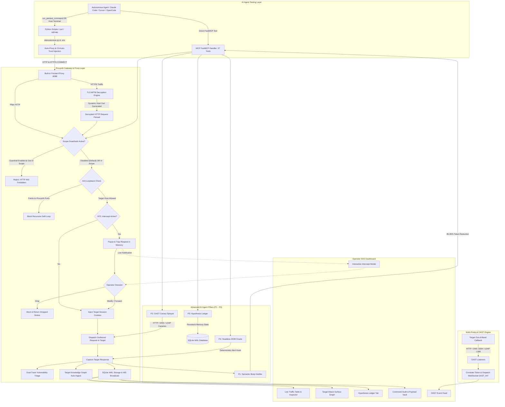

# ⚡ PROXSYNTH // Autonomous Security Testing Gateway & Interception Platform
### Next-Generation Model Context Protocol (MCP) Intercept Proxy, Out-Of-Band Canary Engine, Token Distiller & Attack Hypothesis Ledger for Autonomous AI Red Teaming Agents

[](https://python.org)
[](https://modelcontextprotocol.io)
[](#-complete-mcp-tools-reference-specification-37-tools)
[](https://fastapi.tiangolo.com)
[](https://playwright.dev)
[](https://sqlite.org)
[](#-built-in-forward-interception-proxy--tls-mitm-decryption-engine)
[](#-built-in-forward-interception-proxy--tls-mitm-decryption-engine)
[](#-transparent-runtime-auto-enforcement-sitecustomizepy)
[](#phase-1-target-scope--guardrail-setup-zero-default-guardrails)
[](#pillar-2-p2-autonomous-multi-protocol-oast-canary-sprayer)
[](#pillar-3-p3-agent-working-memory--attack-hypothesis-ledger)
[](#pillar-4-p4-browser-dom-execution-oracle-sandbox)
[](#-license)

---

```
  ██████╗ ██████╗  ██████╗ ██╗  ██╗███████╗██╗   ██╗███╗   ██╗████████╗██╗  ██╗
  ██╔══██╗██╔══██╗██╔═══██╗╚██╗██╔╝██╔════╝╚██╗ ██╔╝████╗  ██║╚══██╔══╝██║  ██║
  ██████╔╝██████╔╝██║   ██║ ╚███╔╝ ███████╗ ╚████╔╝ ██╔██╗ ██║   ██║   ███████║
  ██╔═══╝ ██╔══██╗██║   ██║ ██╔██╗ ╚════██║  ╚██╔╝  ██║╚██╗██║   ██║   ██╔══██║
  ██║     ██║  ██║╚██████╔╝██╔╝ ██╗███████║   ██║   ██║ ╚████║   ██║   ██║  ██║
  ╚═╝     ╚═╝  ╚═╝ ╚═════╝ ╚═╝  ╚═╝╚══════╝   ╚═╝   ╚═╝  ╚═══╝   ╚═╝   ╚═╝  ╚═╝
     ── THE AUTONOMOUS INTERCEPTION PROXY & AGENTIC SECURITY GATEWAY ──
```

---

## 📌 Executive Overview

**PROXSYNTH** is an enterprise-grade security testing gateway, transparent interception proxy, and real-time observability platform engineered specifically for **Autonomous AI Pentesting Agents** (such as **Claude Code**, **Cursor**, **OpenCode**, **Hermes Agent**, **Windsurf**, or custom LLM security workflows communicating via the **Model Context Protocol (MCP)**).

When deploying autonomous AI agents against web applications, cloud APIs, and internal networks, security operators encounter critical operational hurdles that make traditional interception proxies (*Burp Suite*, *Caido*, *mitmproxy*, *OWASP ZAP*) unworkable:

1. **The "Subprocess Scripting Gap & Proxy Evading":** When agents generate standalone exploit scripts (Python `requests`/`httpx`, `curl`, `sqlmap`, `ffuf`, `nuclei`) or execute scripts directly in host terminal/bash, outbound HTTP/HTTPS traffic bypasses proxy listeners, TLS CONNECT tunnels produce blind uninspected noise, and scope boundaries are evaded.
2. **Agent Amnesia & Context Drift:** Autonomous LLM loops suffer from context loss between execution steps. Without persistent structured working memory, agents repeat redundant tests, lose track of verified attack paths, and hallucinate testing conclusions.
3. **Context Window Token Exhaustion:** Feeding raw HTTP response bodies (often 100KB–1MB with HTML layout, inline CSS, SVG paths, and base64 assets) into LLM context windows causes immediate token limit blowouts, sluggish inference, and massive API costs.
4. **Blind Vulnerability Invisibility:** Exploiting Blind SSRF, Blind SQL Injection, Out-of-Band XXE, or Log4j/JNDI callbacks is impossible without an integrated multi-protocol listener that correlates callback hits directly to the originating test request.
5. **False Positive Hallucinated XSS:** LLMs frequently guess whether `<script>alert(1)</script>` fired based purely on reflection in raw HTML, producing hallucinated findings on sanitized or non-executing sinks.
6. **Credential Amnesia & Hallucinated Logins:** Agents lose session cookies across loops, hallucinate expired credentials, or repeatedly interrupt human operators with authentication requests.
7. **Lack of Human-in-the-Loop (HITL) Interception:** Operators cannot pause, inspect, modify, or drop high-risk agent requests before they hit production servers.
8. **Siloed Tooling & Reporting:** Agent interactions remain locked in chat transcripts instead of generating industry-standard security deliverables (**HAR 1.2**, **Burp Suite** archives, **Executive Pentest Reports**, **OpenAPI 3.0 Specs**).

**PROXSYNTH solves every single one of these challenges.** Operating as an intelligent, bidirectional gateway between your AI Agent and the target application, PROXSYNTH provides **transparent forward proxy auto-injection**, **runtime Python auto-enforcement (`sitecustomize.py`)**, **TLS MITM decryption engine with dynamic CA generation**, **stateful attack surface mapping**, **autonomous multi-protocol out-of-band callback listening**, **agent working memory hypothesis ledger**, **LLM semantic body distillation**, **deterministic headless DOM execution verification**, and a **high-density cyberpunk SOC dashboard**.

---

## 🏗️ System Architecture Design

PROXSYNTH isolates agent reasoning and LLM API traffic from target security testing traffic while aggregating telemetry into a unified operator console.

### 1. High-Level Architectural Diagram

```
                                  ┌────────────────────────────────────────────────────────┐
                                  │            AUTONOMOUS AI PENTESTING AGENTS             │
                                  │      (Claude Code / Cursor / OpenCode / Hermes)        │
                                  └───────────────┬────────────────────────┬───────────────┘
                                                  │                        │
                   Direct FastMCP Tools (JSON-RPC)│                        │ Subprocess / Host Script Execution
             (send_http_request, render_webpage)  │                        │ (run_pentest_command OR host terminal)
                                                  │                        │
                                                  │                        ▼
                                                  │         ┌──────────────────────────────────────────────┐
                                                  │         │    Transparent Runtime Hook & Environment    │
                                                  │         │  - sitecustomize.py (Auto-loaded by Python)  │
                                                  │         │  - Workspace .env & Shell Envs Injected      │
                                                  │         │  - Auto-routes requests / httpx to :8088     │
                                                  │         │  - Auto-trusts .proxynth_ca/proxynth_ca.crt  │
                                                  │         └──────────────────────┬───────────────────────┘
                                                  ▼                                │
┌──────────────────────────────────────────────────────────────────────────────────┼───────────────────────────────────────┐
│                                                   PROXSYNTH MCP GATEWAY          │                                       │
│                                                     (mcp_server.py)              │                                       │
│                                                                                  │                                       │
│   ┌──────────────────────────────────────────────┐                               │                                       │
│   │            MCP Tool Boundary (Stdio)         │                               │                                       │
│   │  - 37 Registered FastMCP Tools               │                               │                                       │
│   │  - P1: distill_http_response                 │                               │                                       │
│   │  - P2: spray_oast_canaries                   │                               │                                       │
│   │  - P3: record_hypothesis / get_agenda        │                               │                                       │
│   │  - P4: verify_dom_execution (Playwright)     │                               │                                       │
│   └──────────────────────┬───────────────────────┘                               │                                       │
│                          │                                                       │                                       │
│                          ▼                                                       ▼                                       │
│   ┌──────────────────────────────────────────────────────────────────────────────────────────────────────────────────┐   │
│   │                                       PROXSYNTH SECURITY & INTERCEPTION CORE                                     │   │
│   │                                                                                                                  │   │
│   │   [Built-in Forward Proxy :8088] ──> [TLS MITM Decryption Engine (Dynamic CA Certificate Generation)]            │   │
│   │                                                                                                                  │   │
│   │   [Zero Default Guardrails / Opt-in Scope] ──> [Anti-Loopback Guard] ──> [HITL Intercept Trap]                   │   │
│   │                                                                                                                  │   │
│   │   [Zero-Prompt Cookie Injection] ──> [Dual-Track Vulnerability Triage] ──> [Target Knowledge Graph Ingest]       │   │
│   └──────────────────────────────────────────────┬───────────────────────────────────────────────────────────────────┘   │
│                                                  │                                                                       │
│                 ┌────────────────────────────────┴─────────────────────────────────┐                                     │
│                 │                                                                  │                                     │
│                 ▼                                                                  ▼                                     │
│   ┌───────────────────────────┐                                      ┌───────────────────────────┐                       │
│   │ Async HTTPX Outbound Pool │                                      │ Decrypted Forward Proxy   │                       │
│   │ (Direct MCP Requests)     │                                      │ (Outbound TLS to Target)  │                       │
│   └─────────────┬─────────────┘                                      └─────────────┬─────────────┘                       │
└─────────────────┼──────────────────────────────────────────────────────────────────┼─────────────────────────────────────┘
                  │                                                                  │
                  │ Outbound Security Traffic                                        │ Outbound Script Traffic (requests, curl, sqlmap)
                  ▼                                                                  ▼
        ┌──────────────────┐                                               ┌──────────────────┐
        │  TARGET WEB APP  │                                               │ OAST LISTENERS   │
        │  & REST / GRAPHQL│                                               │ - HTTP :8000     │
        └─────────┬────────┘                                               │ - DNS UDP :5354  │
                  │                                                        │ - LDAP TCP :1390 │
                  │                                                        └─────────┬────────┘
                  │                                                                  │
                  └───────────────────────────────┬──────────────────────────────────┘
                                                  │
                                                  │ Real-Time WebSocket Telemetry & WAL Database
                                                  ▼
                                ┌──────────────────────────────────┐
                                │      FASTAPI ENGINE (APP.PY)     │
                                │   (:8000 or custom port :8081)   │
                                └─────────────────┬────────────────┘
                                                  │
                                                  ▼
                                ┌──────────────────────────────────┐
                                │       OPERATOR SOC CONSOLE       │
                                │  - Live Proxy Traffic Table      │
                                │  - Interactive Intercept Trap    │
                                │  - Target Attack Surface Graph   │
                                │  - OAST Interaction Console      │
                                │  - Attack Hypothesis Ledger (P3) │
                                │  - Vulnerability Findings Ledger │
                                │  - AI Command Audit Trail        │
                                │  - Repeater & Parameter Fuzzer   │
                                │  - HAR 1.2 / Markdown Exporter   │
                                └──────────────────────────────────┘
```

---

### 2. Core Architectural Subsystems Flowchart



---

## ⚡ The 4 Advanced Agentic Pillars (P1 – P4)

PROXSYNTH introduces four cutting-edge subsystems specifically designed to elevate AI agents from blind brute-force scripts into disciplined, cognitive offensive security operators.

---

### Pillar 1 (P1): LLM Semantic Response Body Distiller
* **The Problem:** LLM context windows are easily choked by 200KB–1MB raw HTML responses packed with inline SVG icons, Tailwind CSS classes, base64 data URIs, and third-party tracking scripts.
* **The Solution:** Built-in semantic parser ([`backend/body_distiller.py`](file:///d:/PROJECT/01/backend/body_distiller.py)) that strips layout noise while extracting essential attack-surface intelligence:
  - Form actions, input fields, methods, hidden tokens.
  - REST/GraphQL endpoints, script sources, JSON keys.
  - Reflected parameters and sensitive token strings (`api_key`, `token`, `secret`, `jwt`).
* **Performance:** Achieves **85% to 95% token reduction** with zero critical information loss.
* **MCP Integration:** Tool 32 `distill_http_response` and `send_http_request(distill_response=True)`.

```json
// Example Distilled Output for LLM Consumption
{
  "title": "Account Settings - Target Portal",
  "forms": [
    {"action": "/api/v1/profile/update", "method": "POST", "inputs": [{"name": "email", "type": "text"}, {"name": "csrf_token", "type": "hidden"}]}
  ],
  "api_endpoints": ["/api/v1/profile/update", "/api/v1/billing/invoices"],
  "stats": {"original_bytes": 142500, "distilled_bytes": 1850, "token_reduction_pct": 98.7}
}
```

---

### Pillar 2 (P2): Autonomous Multi-Protocol OAST Canary Sprayer
* **The Problem:** Blind SSRF, Blind SQL Injection, Out-of-Band XXE, and Log4j (JNDI) vulnerabilities produce zero reflection in HTTP response bodies. Agents test blindly and miss critical flaws.
* **The Solution:** Autonomous sprayer ([`backend/oast_sprayer.py`](file:///d:/PROJECT/01/backend/oast_sprayer.py)) that crawls URL parameters, headers, or body values and sprays multi-protocol canaries across four vectors simultaneously:
  1. **HTTP Callback:** `http://127.0.0.1:8000/oast/<token>/payload`
  2. **DNS Callback (UDP :5354):** `<token>.oast.proxynth.local`
  3. **LDAP/JNDI Callback (TCP :1390):** `${jndi:ldap://127.0.0.1:1390/<token>}`
  4. **XXE Out-of-Band Entity:** `<!ENTITY % dtd SYSTEM "http://127.0.0.1:8000/oast/<token>/xxe">`
* **MCP Integration:** Tool 33 `spray_oast_canaries(target_url="https://target/api", vuln_types=["ssrf", "dns", "log4j", "xxe"])`.

---

### Pillar 3 (P3): Agent Working Memory & Attack Hypothesis Ledger
* **The Problem:** AI agents operate statelessly between user prompts. They forget what was tested, repeat redundant exploits, and fail to track the progression of a multi-stage attack.
* **The Solution:** Stateful Hypothesis Ledger ([`backend/hypothesis_manager.py`](file:///d:/PROJECT/01/backend/hypothesis_manager.py) + SQLite model `TestingHypothesis`) tracking testing lifecycle states:
  - `PLANNED` ➔ `TESTING` ➔ `CONFIRMED` | `DISPROVEN` | `BLOCKED`
* **Autonomous Agenda Calculation:** `get_testing_agenda` synthesizes pending attack avenues and prevents looping.
* **Real-Time Synchronized UI:** Dedicated "Hypothesis Ledger" dashboard tab featuring metric cards, status filters, and live WebSocket broadcasts (`HYPOTHESIS_CREATED`, `HYPOTHESIS_UPDATED`, `HYPOTHESIS_DELETED`).
* **MCP Integration:** Tools 34–36 (`record_testing_hypothesis`, `get_testing_agenda`, `update_hypothesis_status`).

---

### Pillar 4 (P4): Browser DOM Execution Oracle Sandbox
* **The Problem:** LLMs guess whether an XSS payload executed by searching for the reflected string in the response body. This produces rampant false positives in attribute contexts, encoded blocks, or sanitization sinks.
* **The Solution:** Sandboxed headless Playwright Chromium oracle ([`backend/browser_oracle.py`](file:///d:/PROJECT/01/backend/browser_oracle.py)) that renders the target URL with the payload and hooks:
  - `window.alert`, `window.confirm`, `window.prompt` dialogs.
  - Page console logs and unhandled error events.
  - Dynamic DOM script elements and sink mutations.
* **Deterministic Verdict:** Returns `CONFIRMED_DOM_EXECUTION` with exact dialog message and URL context, or `NO_DOM_EXECUTION`.
* **MCP Integration:** Tool 37 `verify_dom_execution(url="https://target/search", payload="<script>alert(1)</script>")`.

---

## 🧰 Complete MCP Tools Reference Specification (37 Tools)

PROXSYNTH's FastMCP server (`mcp_server.py`) registers **37 enterprise-grade offensive security tools**:

| # | Tool Name | Subsystem / Pillar | Primary Operational Capability |
| :---: | :--- | :--- | :--- |
| **1** | `send_http_request` | Core Network | High-performance HTTP/HTTPS dispatcher with auto-auth injection, scope checks, intercept trap, and response body distillation (`distill_response=True`). |
| **2** | `get_log_detail` | Telemetry & History | Retrieves full un-truncated HTTP request/response headers and bodies by Log ID. |
| **3** | `get_traffic_history` | Telemetry & History | Lists recent HTTP transactions with status codes, latency, and triage tags. |
| **4** | `browser_navigate_and_render` | Browser Automation | Headless Playwright engine capturing dynamic DOM and network Fetch/XHR calls. |
| **5** | `request_manual_login` | Authentication | Spawns visible browser for human operator to solve CAPTCHA/2FA; auto-imports session cookies. |
| **6** | `get_attack_surface` | Attack Surface | Returns hierarchical topology graph of assets, open ports, and endpoints. |
| **7** | `record_target_asset` | Reconnaissance | Explicitly catalogs a host/machine, IP address, OS, and status in the knowledge graph. |
| **8** | `record_target_service` | Reconnaissance | Records open ports, protocols (TCP/UDP), and service banners for a target asset. |
| **9** | `record_target_endpoint` | Reconnaissance | Catalogs target URL routes, parameters, auth requirements, and testing status (`UNTESTED`, `TESTED_VULNERABLE`). |
| **10** | `generate_oast_token` | OAST Engine | Generates unique correlation token and callback URLs for Out-of-Band testing. |
| **11** | `poll_oast_events` | OAST Engine | Queries captured callbacks (HTTP, DNS, LDAP) for a specific OAST token. |
| **12** | `record_test_payload` | Payload Vault | Stores exploit strings into the Payload Vault with categorization and tags. |
| **13** | `report_vulnerability` | Findings & Audit | Flags an HTTP log entry as a confirmed vulnerability finding in the operator ledger. |
| **14** | `run_pentest_command` | Subprocess Execution | Executes terminal commands (`curl`, `sqlmap`, `nuclei`) with auto-proxy routing to `:8088` and audit logging. |
| **15** | `set_identity_session` | BOLA / IDOR Matrix | Registers secondary user identity cookies (e.g., attacker/victim) for shadow replay testing. |
| **16** | `test_bola_idor` | BOLA / IDOR Matrix | Executes dual-track BOLA replay against an endpoint using registered identity roles. |
| **17** | `analyze_waf_response` | WAF Evasion | Fingerprints target WAF vendor (Cloudflare, AWS WAF, Akamai) and recommends bypass tactics. |
| **18** | `mutate_payload` | WAF Evasion | Generates obfuscated payload variations (URL, hex, comment injection, Unicode bypass). |
| **19** | `infer_hidden_endpoints` | API Reconstructor | Predicts unmapped REST endpoints (admin, actuator, docs, CRUD variants) from observed paths. |
| **20** | `get_attack_paths` | Attack Chains | Synthesizes Kill Chain attack paths from initial recon to Crown Jewels (RCE, DB dump). |
| **21** | `generate_exploit_poc` | PoC Generator | Generates standalone Python PoC scripts, cURL commands, and CVSS/CWE dossiers for findings. |
| **22** | `send_websocket_message` | WebSocket Audit | Transmits and logs WebSocket frames to target socket endpoints for real-time protocol testing. |
| **23** | `fuzz_endpoint` | Parameter Fuzzer | High-speed dictionary fuzzing against marker positions (`§...§`) with status and length delta analysis. |
| **24** | `execute_workflow_sequence` | Business Logic | Executes multi-step stateful workflows with dynamic variable extraction and step-skipping bypass checks. |
| **25** | `test_race_condition` | Concurrency Burst | Executes microsecond-synchronized request bursts using `asyncio.Barrier` to detect double-spending. |
| **26** | `mine_javascript_assets` | JS Recon | Scrapes frontend `.js` bundles for hidden API routes, query params, source maps, and leaked API secrets. |
| **27** | `compare_http_responses` | Diff Engine | Normalizes dynamic noise (timestamps, UUIDs, CSRF nonces) to detect Soft-403/404 anomalies. |
| **28** | `audit_jwt_security` | JWT Security | Audits JWT tokens for Algorithm None bypass, weak HMAC offline brute-forcing, and claim tampering. |
| **29** | `delete_attack_surface_node` | Attack Surface | Prunes stale or false-positive assets, services, or endpoints from the knowledge graph. |
| **30** | `clear_attack_surface_graph` | Attack Surface | Wipes all attack surface records for a project workspace to reset reconnaissance. |
| **31** | `get_intercept_status` | HITL Intercept | Checks whether the human-in-the-loop intercept trap is active and returns pending trapped requests. |
| **32** | `distill_http_response` | **P1: Distiller** | Compresses HTML/JSON bodies into semantic security structures, achieving 85–95% token savings. |
| **33** | `spray_oast_canaries` | **P2: OAST Sprayer** | Discovers input parameters and sprays multi-protocol canaries (HTTP, DNS, LDAP/JNDI, XXE) across a target URL. |
| **34** | `record_testing_hypothesis` | **P3: Memory** | Logs an attack hypothesis into the stateful ledger (`target`, `vuln_type`, `hypothesis`, `parameters`). |
| **35** | `get_testing_agenda` | **P3: Memory** | Synthesizes an actionable testing agenda of unverified hypotheses to eliminate agent loops. |
| **36** | `update_hypothesis_status` | **P3: Memory** | Transitions hypothesis lifecycle state (`PLANNED` ➔ `TESTING` ➔ `CONFIRMED` / `DISPROVEN` / `BLOCKED`). |
| **37** | `verify_dom_execution` | **P4: DOM Oracle** | Executes payload in sandboxed Playwright Chromium to deterministically verify XSS/DOM sinks. |

---

## 🥊 Head-to-Head Comparison: Why AI Agents Need Proxynth

Traditional interception proxies were built for human eyes and manual clicks. When autonomous AI agents use them, critical architectural failures emerge:

| Feature / Capability | PROXSYNTH | Burp Suite Professional | Caido | mitmproxy | OWASP ZAP |
| :--- | :---: | :---: | :---: | :---: | :---: |
| **Native Model Context Protocol (FastMCP)** | ✅ **Yes (37 Tools)** | ❌ No | ❌ No | ❌ No | ❌ No |
| **Python Script Auto-Interception (`sitecustomize.py`)** | ✅ **Automatic** | ❌ Manual config | ❌ Manual config | ❌ Manual config | ❌ Manual config |
| **Agent Working Memory (Hypothesis Ledger P3)** | ✅ **Built-in** | ❌ No | ❌ No | ❌ No | ❌ No |
| **LLM Semantic Response Distiller (P1: 90% Savings)** | ✅ **Built-in** | ❌ No | ❌ No | ❌ No | ❌ No |
| **Autonomous Multi-Protocol OAST Sprayer (P2)** | ✅ **HTTP/DNS/LDAP** | ⚠️ Burp Collaborator | ❌ No | ❌ No | ⚠️ OAST Addon |
| **Headless DOM Execution Oracle Sandbox (P4)** | ✅ **Playwright Hook** | ❌ No | ❌ No | ❌ No | ❌ No |
| **Zero Guardrails by Default (Local & Labs Work)** | ✅ **Yes** | ✅ Yes | ✅ Yes | ✅ Yes | ⚠️ Complex rules |
| **Dual-Track Vulnerability Triage (Confirmed vs Pot)** | ✅ **Automated** | ⚠️ Scanner Tab | ❌ No | ❌ No | ⚠️ Alert Tree |
| **Human-in-the-Loop Intercept Trap via WebSockets** | ✅ **Yes** | ✅ Yes (GUI) | ✅ Yes (GUI) | ✅ Yes (CLI/Web) | ✅ Yes (GUI) |
| **CLI Pentest Tool Correlation (`sqlmap`, `nuclei`)** | ✅ **Auto-Tagged** | ⚠️ If proxied | ⚠️ If proxied | ⚠️ If proxied | ⚠️ If proxied |
| **One-Click Standalone Python PoC Generator** | ✅ **Built-in** | ❌ Extension | ❌ No | ❌ No | ❌ No |
| **Lightweight Headless Deployment (<50MB RAM idle)** | ✅ **FastAPI+Async** | ❌ Heavy Java JVM | ✅ Rust core | ✅ Python | ❌ Java JVM |

---

## 🐍 Transparent Runtime Auto-Enforcement (`sitecustomize.py`)

When AI agents generate and execute custom scripts (e.g. Python `requests`, `httpx`, `urllib`, `aiohttp`, `curl`, `sqlmap`, `ffuf`, `nuclei`), traffic frequently evades proxies because agents forget to specify `--proxy` or configure SSL certificates.

### How Proxynth Solves the Scripting Gap:
1. **Zero-Configuration Startup:** Python's `site` module automatically loads [`sitecustomize.py`](file:///d:/PROJECT/01/sitecustomize.py) from the workspace root or `site-packages` on interpreter startup before any script runs.
2. **Environment Auto-Injection:** Automatically injects:
   ```bash
   HTTP_PROXY="http://127.0.0.1:8088"
   HTTPS_PROXY="http://127.0.0.1:8088"
   REQUESTS_CA_BUNDLE="./.proxynth_ca/proxynth_ca.crt"
   SSL_CERT_FILE="./.proxynth_ca/proxynth_ca.crt"
   CURL_CA_BUNDLE="./.proxynth_ca/proxynth_ca.crt"
   PYTHONHTTPSVERIFY="0"
   ```
3. **TLS MITM Decryption:** The Forward Proxy (`:8088`) generates dynamic host certificates on the fly, decrypts HTTPS CONNECT tunnels, and parses HTTP methods, paths, and bodies.
4. **Legitimate User-Agent Rotation:** Transparently rotates legitimate desktop browser User-Agents (Chrome, Firefox, Safari, Edge) and Client Hints (`sec-ch-ua`) to bypass bot detection.
5. **Anti-Self-Loopback:** Proxynth automatically detects requests destined for its own dashboard (`:8000`) or proxy (`:8088`) and bypasses interception to prevent deadlocks.

```python
# The AI Agent writes and executes this simple script:
import requests

# Zero custom proxy configuration needed!
# AUTOMATICALLY routed to :8088, decrypted by TLS MITM, and logged in Proxynth Dashboard!
res = requests.get("https://target.local/api/vuln?id=1' OR 1=1--")
print(res.status_code, res.text[:200])
```

---

## 🚀 Installation & Quick Start

### 1. Prerequisites
- **Python:** 3.10, 3.11, 3.12, 3.13, or 3.14
- **Operating System:** Windows 10/11, Linux (Ubuntu/Debian/Kali/Arch), or WSL2
- **Node/Playwright:** Installed automatically by installer script

---

### 2. Automated One-Click Installation (Recommended)

PROXSYNTH includes automated installers that provision the virtual environment, install dependencies, fetch the Playwright Chromium browser, and generate root CA certificates:

#### 🪟 Windows (CMD or PowerShell):
```cmd
:: Using Command Prompt:
install.bat

:: OR using PowerShell:
.\install.ps1
```

#### 🐧 Linux & WSL2:
```bash
chmod +x install.sh run.sh
./install.sh
```

---

### 3. Launching PROXSYNTH

| Mode | Command (Windows) | Command (Linux / WSL2) | What It Runs |
| :--- | :--- | :--- | :--- |
| **Dashboard Only** | `run.bat` or `run.bat dashboard` | `./run.sh dashboard` | FastAPI Web Dashboard (:8000), Forward Proxy (:8088), DNS OAST (:5354), LDAP OAST (:1390) |
| **FastMCP Server Only** | `run.bat mcp` | `./run.sh mcp` | Headless FastMCP Stdio Server (for Claude Desktop, Cursor, OpenCode) |
| **Dual Mode (All)** | `run.bat all` | `./run.sh all` | Launches Web Dashboard in background window and FastMCP Server in foreground |

Once started:
- 🌐 **Web Dashboard:** `http://127.0.0.1:8000`
- 🎯 **OAST HTTP Callback:** `http://127.0.0.1:8000/oast/{token}/*`
- 🔄 **Forward Interception Proxy:** `http://127.0.0.1:8088`
- 📡 **OAST DNS Listener:** UDP `0.0.0.0:5354`
- ⚡ **OAST LDAP/JNDI Listener:** TCP `0.0.0.0:1390`

---

## 🤖 AI Agent Integration Guide

Connect your autonomous agent to PROXSYNTH via standard Model Context Protocol configuration:

### 1. Claude Desktop & Claude Code
Add PROXSYNTH to your `claude_desktop_config.json`:
- **Windows:** `%APPDATA%\Claude\claude_desktop_config.json`
- **macOS:** `~/Library/Application Support/Claude/claude_desktop_config.json`

```json
{
  "mcpServers": {
    "proxynth": {
      "command": "d:\\PROJECT\\01\\venv\\Scripts\\python.exe",
      "args": [
        "d:\\PROJECT\\01\\mcp_server.py"
      ],
      "env": {
        "PROXSYNTH_BACKEND_URL": "http://127.0.0.1:8000",
        "PROXSYNTH_PROJECT": "default",
        "PYTHONIOENCODING": "utf-8"
      }
    }
  }
}
```

### 2. Cursor IDE
Add to `.cursor/mcp.json` or Cursor Settings > MCP:
```json
{
  "mcpServers": {
    "proxynth": {
      "command": "d:/PROJECT/01/venv/Scripts/python.exe",
      "args": ["d:/PROJECT/01/mcp_server.py"],
      "env": {
        "PROXSYNTH_BACKEND_URL": "http://127.0.0.1:8000",
        "PROXSYNTH_PROJECT": "default"
      }
    }
  }
}
```

### 3. OpenCode & Hermes Agent
Add to `mcp_config.json` or `opencode.json`:
```json
{
  "mcpServers": {
    "proxynth": {
      "command": "d:/PROJECT/01/venv/Scripts/python.exe",
      "args": ["d:/PROJECT/01/mcp_server.py"],
      "env": {
        "PROXSYNTH_BACKEND_URL": "http://127.0.0.1:8000",
        "PROXSYNTH_PROJECT": "client-alpha",
        "PYTHONIOENCODING": "utf-8"
      }
    }
  }
}
```

---

## 🖥️ Cyberpunk SOC Operator Console Tour

PROXSYNTH's web console (`http://127.0.0.1:8000`) is a high-density, cyberpunk-styled security operations dashboard featuring 9 dedicated views:

1. **Proxy Traffic Ledger:** Live table supporting virtual scrolling for 100,000+ records, resizable columns, per-column text/regex filters, and split-pane request/response inspector. Includes "Distill (P1)" semantic view toggle.
2. **Interactive Intercept Trap:** Pause high-risk agent requests before they reach the target. Inspect headers, modify SQLi payloads on the fly, and choose to **Forward** or **Drop**.
3. **Target Attack Surface Knowledge Graph:** Relational asset inventory (`Host -> Port -> Route`) with live testing state tags (`UNTESTED`, `IN_PROGRESS`, `TESTED_CLEAN`, `TESTED_VULNERABLE`). Includes single-node and whole-graph deletion options.
4. **OAST Interaction Console:** Real-time event log capturing out-of-band HTTP callbacks, DNS resolutions, and JNDI queries. Includes interactive "Spray Canaries (P2)" modal.
5. **Attack Hypothesis Ledger (P3):** Interactive kanban and list view tracking agent working memory. Real-time metric cards (`PLANNED`, `TESTING`, `CONFIRMED`, `DISPROVEN`, `BLOCKED`) with live WebSocket synchronization.
6. **Vulnerability Findings Ledger:** Automated classification of confirmed and potential findings with evidence snippets, CVSS scores, and 1-Click standalone Python PoC generation.
7. **AI Command Audit Trail:** Complete terminal execution history for `run_pentest_command` displaying sanitized commands, exit codes, working directory, and stdout/stderr streams.
8. **Repeater & Parameter Fuzzer:** Manual replay workbench with baseline diff analyzer, "Distill Response (P1)" toggle, and "Verify DOM (P4)" execution oracle.
9. **Settings & Guardrails:** Opt-in scope enforcement, authorized host wildcards, sensitive regex filters, and upstream proxy chaining (e.g. chaining to Burp Suite at `http://127.0.0.1:8080`).

---

## ⚙️ Configuration & Environment Variables

PROXSYNTH is fully customizable via `.env` or system environment variables:

| Variable | Default Value | Description |
| :--- | :--- | :--- |
| `PROXSYNTH_PORT` | `8000` | Port for the FastAPI dashboard and WebSocket server |
| `PROXSYNTH_BACKEND_URL` | `http://127.0.0.1:8000` | Base URL used by FastMCP tools and client SDKs |
| `PROXSYNTH_PROXY_PORT` | `8088` | Port for the Built-in Forward Interception Proxy |
| `PROXSYNTH_PROXY_HOST` | `127.0.0.1` | Host interface bound by the Forward Proxy |
| `PROXSYNTH_DNS_PORT` | `5354` | Port for the built-in UDP DNS OAST callback listener |
| `PROXSYNTH_LDAP_PORT` | `1390` | Port for the built-in TCP LDAP/JNDI OAST callback listener |
| `PROXSYNTH_PROJECT` | `default` | Default workspace project identifier |
| `PROXSYNTH_UPSTREAM_PROXY` | `""` *(empty)* | Optional upstream proxy for chaining (e.g., `http://127.0.0.1:8080`) |
| `PROXSYNTH_DB_PATH` | `./spectra.db` | Path to the SQLite WAL database file |
| `PROXSYNTH_API_KEY` | `""` *(empty)* | Optional security token requiring `X-Proxynth-Key` header |
| `PROXSYNTH_ALLOW_REMOTE` | `false` | When false, restricts dashboard access strictly to loopback (`127.0.0.1`) |
| `PROXSYNTH_MAX_BODY_SIZE` | `524288` (512 KB) | Maximum byte threshold stored per request/response body in SQLite |

*(Note: All legacy `SPECTRA_*` environment variables remain supported as backwards-compatible fallbacks).*

---

## 🏷️ GitHub SEO & Repository Optimization Recommendations

To maximize visibility and ensure PROXSYNTH trends on GitHub and ranks #1 on Google, apply the following metadata to your GitHub repository:

* **Repository Name:** `proxynth` (or `Proxynth-MCP`)
* **Description:** `⚡ Autonomous AI Interception Proxy, Multi-Protocol OAST Engine & Attack Hypothesis Ledger for LLM Pentesting Agents (Claude Code, Cursor, OpenCode, Hermes)`
* **Website:** `http://127.0.0.1:8000` or documentation portal
* **Topics / Tags:**
  ```
  mcp  model-context-protocol  ai-agent  pentesting  burp-suite-alternative  caido  red-teaming  autonomous-agent  oast  bugbounty  cybersecurity  security-tools  fastmcp
  ```

---

## ⚖️ Legal & Ethical Disclaimer

> [!CAUTION]
> **PROXSYNTH is engineered strictly for authorized penetration testing, security auditing, red teaming, and academic vulnerability research.**
> Executing security assessments against target systems without explicit, prior written authorization from the system owner is illegal and violates computer fraud regulations. The authors assume no liability for misuse, unauthorized testing, or damage caused by this software. Always test responsibly within authorized scopes.

---

## 📄 License

PROXSYNTH is distributed under the **MIT License**. See [`LICENSE`](file:///d:/PROJECT/01/LICENSE) for details.
